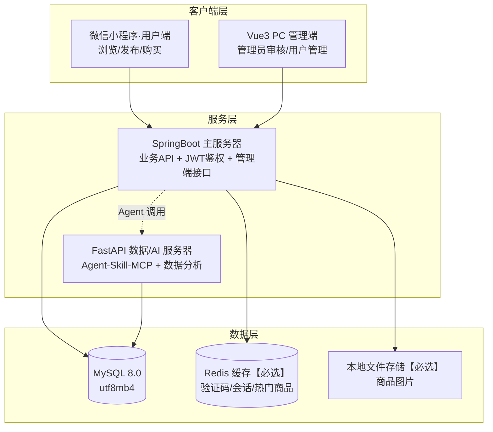

# 校园二手物品交易平台 · 系统设计基线（DESIGN.md）

> **维护规则**：本文件是全组设计的单一事实来源（Single Source of Truth）。任何设计变更必须走 feature 分支修改本文件，经组长合并进 develop，并在 `CHANGELOG.md` 记录。各文档与本文件冲突时，以本文件为准。
> 课程：东南大学 计算机科学与技术专业 · 软件开发综合课程设计（B09P0090）｜小组（张雨薇·组长、万佰鑫、周子航）

## 1. 定位与范围

- **选题**：校园二手物品交易平台（教师题库·普通业务系统通道）。
- **规模底线**：用户权限模块 + 商品发布 + 购物交易 + 交互流程，共 8 条核心 user story。
- **范围三级裁剪**：

| 级别 | 内容 |
|---|---|
| 必做 | 注册登录（手机号+验证码）、商品发布/浏览、购物车、订单交易（模拟支付）、管理员审核 |
| 可选 | 评价体系、消息通知 |
| 第一版不做 | 即时聊天、复杂风控、第三方真实支付（用模拟支付）、ES 搜索（用 MySQL LIKE/索引代替） |

## 2. 总体架构

- 前后端分离；小程序面向普通用户，PC 管理端面向平台管理员。
- Agent 链路：用户自然语言 → FastAPI Agent → MCP 报文 → Skill 鉴权 → 转发业务 API（详见 §7）。

## 3. 技术栈

| 层 | 选型 |
|---|---|
| 用户端 | 微信小程序原生（WXML/WXSS/JS） |
| 管理端 | Vue3 + Vite + Element Plus |
| 主服务 | Java 17 + SpringBoot 3 + MyBatis-Plus + JWT |
| 数据/AI 服务 | Python 3.11 + FastAPI + Pydantic + SQLAlchemy |
| 数据库 | MySQL 8.0（InnoDB，utf8mb4_unicode_ci） |
| 缓存 | Redis（验证码、热门商品列表）【必选】 |
| 文件 | 本地磁盘存储商品图片，Nginx/静态映射【必选】 |

## 4. 角色与 RBAC 框架

公式：**用户 → 角色 → 权限**。

| 角色 | 身份说明 | 核心权限 |
|---|---|---|
| 游客 | 未登录 | 浏览商品、搜索 |
| 普通用户 | 买家/卖家合一 | 注册登录、发布/编辑/下架自己的商品、购物车、下单、模拟支付、个人信息维护 |
| 平台管理员 | 审核与管理 | 下架违规商品（填写原因）、管理用户账号（封禁/解封）、查看全部订单、查看操作日志 |

> Agent 服务账号 `agent-svc` 是第四个特殊"用户"：仅拥有 Skill 清单（§7）内允许的操作权限。

## 5. 模块划分与分工

| 模块 | 负责人 | 范围 |
|---|---|---|
| 用户及权限模块 | 张雨薇（组长） | 注册/登录/找回密码/权限校验/账号管理/操作日志，RBAC 落地 |
| 商品发布模块 | 万佰鑫 | 商品 CRUD、分类、多图上传、库存、上下架、审核流 |
| 购物交易模块 | 周子航 | 购物车、订单、模拟支付、状态流转、交易记录 |
| Agent-Skill-MCP 子系统 | 周子航（方案）+ 张雨薇（集成） | 课次 15 集成，本阶段只出方案与契约 |
| 文档与集成 | 张雨薇 | 需求文档索引、Git 规约、变更历史、阶段测试 |

## 6. 核心数据表（概要，详表在需求文档数据库章节）

`user`(id, phone*唯一*, password_hash, nickname, avatar, role, status, create_time)
`category`(id, name, parent_id, sort)
`goods`(id, seller_id, category_id, title, description, price, stock, status[在售/下架/待审核], create_time)
`goods_image`(id, goods_id, url, sort)
`cart_item`(id, user_id, goods_id, num)
`orders`(id, order_no, buyer_id, goods_id, deal_price, status[待支付/已支付/已完成/已取消], create_time)
`review`(id, order_id, rater_id, ratee_id, score, content, create_time)【可选】
`message`(id, user_id, type, content, is_read, create_time)【可选】
`agent_chat_log`(id, user_id, prompt, response, skill_name, status, create_time)
`admin_op_log`(id, admin_id, action, target_type, target_id, detail, create_time)

## 7. Agent-Skill-MCP 方案基线

### Skill 能力清单（7 字段）

| 编号 | 名称 | 能力描述 | 输入参数 | 返回核心字段 | 允许操作 | 禁止操作 |
|---|---|---|---|---|---|---|
| SK-001 | 商品信息查询 | 按条件查询在售商品公开信息 | 分类id、关键词、页码 | 商品id、标题、价格、状态 | 按条件查询 | 修改/删除商品、获取卖家手机号 |
| SK-002 | 商品发布辅助 | 润色商品描述、推荐分类 | 商品草稿文本 | 建议标题、描述、分类id | 生成建议文本 | 直接落库发布（须用户确认） |
| SK-003 | 订单状态查询 | 查询当前用户订单状态 | 订单号 | 状态、时间节点 | 查询本人订单 | 查询他人订单、取消/修改订单 |

### 安全约束

- Agent 走独立服务账号 `agent-svc`，不复用用户登录 Token；Skill 层先鉴权再转发。
- 越权拦截：Skill-MCP 层拒绝超出服务账号权限的任何指令（如"删除全部商品"）。
- 操作留痕：所有 Agent 调用写 `agent_chat_log`（服务账号、Skill 名、入参、时间、结果）。

### MCP 报文与错误码

- 请求：`request_id, service_account, skill_id, params, timestamp`；响应：`code, msg, data`。
- 错误码：`4001` 参数非法、`4003` 权限不足、`5000` 业务错误。

## 8. 接口规范基线

- 统一前缀 `/api/v1/`；返回 `{code, msg, data}`；登录/验证码接口外一律 `Authorization: Bearer {token}`（JWT）。

## 9. User Stories（8 条，实验验收口径）

1. US-01 普通用户用手机号+验证码注册账号（手机号唯一）
2. US-02 用户登录、找回密码（JWT 鉴权）
3. US-03 卖家发布商品（标题/描述/价格/分类/多图/库存）
4. US-04 用户按分类与关键词浏览搜索商品
5. US-05 买家加入购物车并提交订单，完成模拟支付
6. US-06 卖家编辑、下架自己的商品
7. US-07 管理员下架违规商品并填写原因，记录操作日志
8. US-08 管理员管理用户账号（封禁/解封）并查看日志

## 10. Git 与协作规范（摘要，全文见 CONTRIBUTING.md）

- 分支：`main`（验收稳定版，禁止直推）→ `develop`（开发主干）→ `feature/模块名-姓名缩写`。
- 提交：`[模块名] 前缀：描述`，前缀 feat/fix/docs/refactor；小步提交；先更新再提交再推送。
- 红线：严禁密钥/密码入库（`.env` 已 ignore）；禁止暴力覆盖他人代码。

## 11. 里程碑

| 时间 | 节点 |
|---|---|
| 2026-10-15 前 | 《软件需求分析报告》组长单独发老师 |
| 2026-10-22 前 | 原型 `原型交付包.zip` 组长单独发老师 |
| 课次 15 | Agent 基座 / Skill / MCP 集成开发与测试 |
| 期末 | 原型验收与答辩、课程设计报告（main 分支稳定版） |
