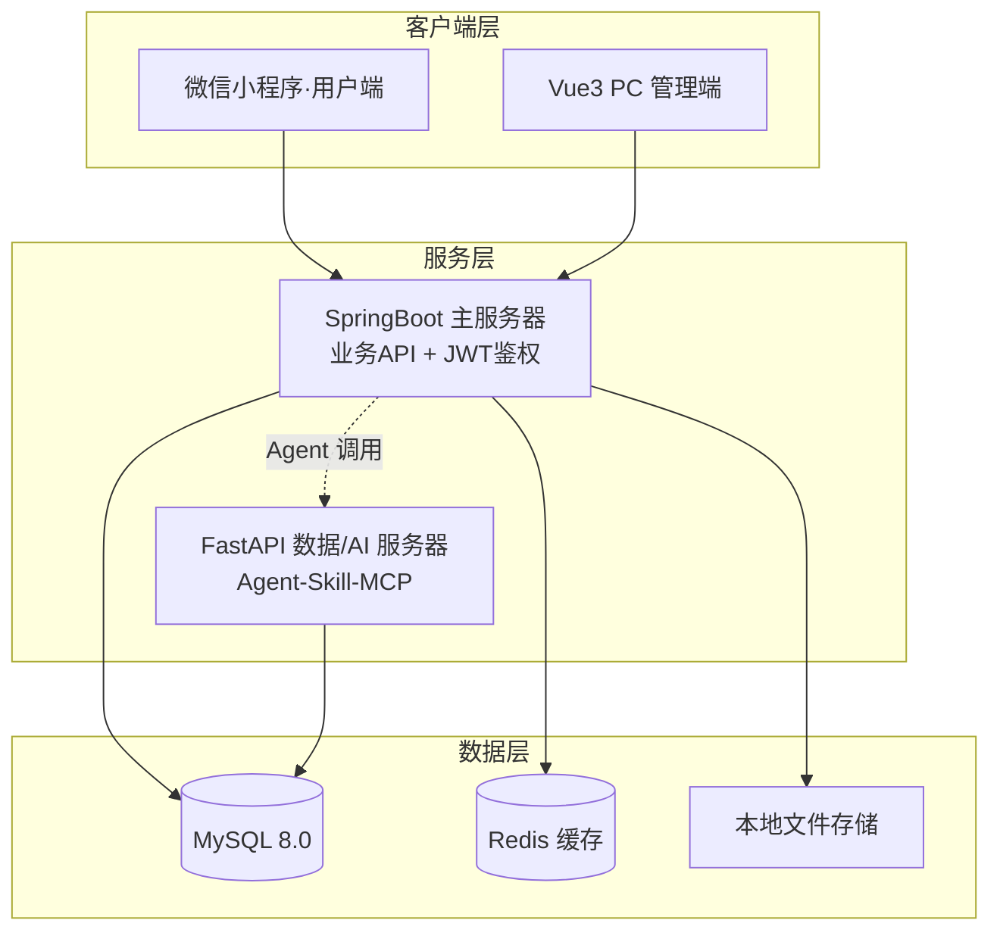

# 校园二手物品交易平台

> 东南大学 计算机科学与技术专业 · 软件开发综合课程设计（B09P0090）
> 小组成员：张雨薇（组长）、万佰鑫（核心开发）、周子航

面向校园场景的二手物品交易系统：学生通过**微信小程序**浏览、发布、购买二手物品，管理员通过 **PC 管理端**完成商品审核与用户管理，并接入 **Agent-Skill-MCP** 智能能力（7 项 Skill：商品查询、发布辅助、订单查询、商品比对、选购建议、智能下单草稿、识图生成发布描述），用自然语言完成查询、比对、买前决策与下单引导。

## 功能总览

| 模块 | 负责人 | 核心能力 |
|---|---|---|
| 用户及权限 | 张雨薇 | 手机号+验证码注册、登录/找回密码、JWT 鉴权、RBAC 三级权限（游客/普通用户/平台管理员/Agent 服务账号）、管理员封禁与操作日志 |
| 商品发布 | 万佰鑫（核心开发） | 商品发布/编辑/下架（状态机：草稿→待审核→在售→已下架/已售出）、分类、多图上传、库存、违规审核、急售标记、运费（0=包邮）、热度数据（浏览/加购） |
| 购物交易 | 周子航 | 购物车、订单（待支付→已支付→已完成/已取消）、模拟支付、运费快照与总额、30 分钟超时自动取消、交易记录 |
| Agent-Skill-MCP | 周子航（方案）/张雨薇（集成） | SK-001~007 七项 Skill（查询/发布辅助/订单/比对/建议/下单草稿/识图）；独立服务账号鉴权、越权拦截、多轮对话与追问、操作留痕；LLM 支持文本+视觉（doubao-seed-2.0-mini，可切换） |

> **分工说明**：万佰鑫为核心开发，除商品发布模块全栈（需求/原型/数据库/接口）外，还负责四端工程脚手架规划（`server-*`、`miniprogram`、`admin-web`）、阶段校验脚本（`tools/validate_phase2.py`）与项目文档主笔（本 README 等）；张雨薇（组长）负责用户及权限模块、文档与集成、合并发布；周子航负责购物交易模块与 Agent-Skill-MCP 方案。

## 系统架构



## 技术栈

| 层 | 选型 |
|---|---|
| 用户端 | 微信小程序原生（WXML/WXSS/JS） |
| 管理端 | Vue3 + Vite + Element Plus |
| 主服务 | Java 17 + SpringBoot 3 + MyBatis-Plus + JWT |
| 数据/AI 服务 | Python 3.11 + FastAPI + Pydantic + SQLAlchemy |
| 数据库 | MySQL 8.0（InnoDB，utf8mb4_unicode_ci） |
| 缓存 | Redis（验证码、会话、热门商品） |
| 文件 | 本地磁盘存储商品图片 |

## 仓库结构

```
├── DESIGN.md                    # 设计基线（单一事实来源：架构/RBAC/数据表/Skill清单/接口基线）
├── 软件需求分析报告.md           # 需求文档（九章节单文件，课程交付物）
├── 测试报告.md                   # 测试报告（用例/四层验证/压测/缺陷闭环）
├── 演示指南.md                   # 验收演示脚本（环境启动/逐端流程/问答锚点）
├── CONTRIBUTING.md              # Git 团队协作规约
├── CHANGELOG.md                 # 变更历史（逐条对应 git log）
├── 工作日志.md                   # 三人工作汇总（阶段评审会议用）
├── report/                      # 个人工作记录
├── design/                      # 设计文档（接口规范总则、db/api 分模块、开源预调研）
├── prototype/                   # 页面原型（纯静态 HTML，index.html 为导航入口）
├── server-springboot/           # 主服务（SpringBoot 3，39 契约端点，:8080）
├── server-fastapi/              # Agent/数据服务（FastAPI，7 项 Skill，:8100）
├── miniprogram/                 # 微信小程序（12 页原生实现）
├── admin-web/                   # PC 管理端（Vue3 + Element Plus，5 视图）
└── tools/                       # 校验与压测脚本（validate_report/validate_phase2/stress_test）
```

## 快速开始（运行真实系统）

```bash
docker start campus-mysql campus-redis          # MySQL 8 + Redis 7（见 docker run 于 演示指南.md §1）
cd server-springboot && mvn spring-boot:run     # :8080，首次自动建表+种子数据
cd server-fastapi && uvicorn app.main:app --port 8100   # Agent 服务（LLM 凭证走环境变量）
cd admin-web && npm install && npm run dev      # :5173 管理端
# 小程序：微信开发者工具导入 miniprogram/（详情见其 README）
```

演示账号与逐端演示脚本见 `演示指南.md`。

- **查看原型**：浏览器直接打开 `prototype/index.html`，从导航进入全部 16 个页面。
- **设计对齐**：所有设计与开发以 `DESIGN.md` 为准，接口遵循 `design/接口规范总则.md`（统一 `/api/v1` 前缀、`{code, msg, data}` 返回、JWT 鉴权）。

## Git 协作（摘要）

- 分支：`main`（稳定发布，仅经 develop 合入）→ `develop`（开发主干）→ `feature/模块名-姓名缩写`（个人开发分支）。
- 提交：`[模块名] 前缀：描述`，前缀 feat/fix/docs/refactor；小步提交，先更新再提交再推送。
- 红线：禁止直接 push main；严禁密钥/密码入库。完整规约见 `CONTRIBUTING.md`。

## 质量校验

```bash
python3 tools/validate_report.py     # 需求文档结构与条目校验
python3 tools/validate_phase2.py     # 原型/数据库/接口文档/密钥校验
python3 tools/stress_test.py         # 压测（50 并发×3000 请求，NFR-01 判定）
node miniprogram/tests/run.js        # 小程序契约测试（31 端点对照）
```

结果记录于 `CHANGELOG.md` 与 `测试报告.md`。

## 已知边界与生产化清单

当前版本是**课程演示态**（默认 `dev` profile），刻意保留了若干开发便利。以下每一项都已用 profile 或配置隔离，上线前需逐项处理：

| 项 | 现状 | 生产化做法 |
|---|---|---|
| 短信验证码 | 无真实通道，`dev/test` profile 在 `data.devCode` 回显 | 接短信服务商；非 dev profile 已自动不回显 |
| 种子账号 | dev 启动时把 3 个种子账号密码重置为文档值 | 非 dev profile 已跳过重置；生产不导入 `seed.sql` |
| JWT 密钥 | 默认值写在仓库里 | 非 dev profile 启动即失败，必须注入 ≥32 字节 `JWT_SECRET`（两个服务同值） |
| agent-svc 服务账号 | 约定凭证 + `X-User-Id` 传用户上下文 | 改内网共享密钥/短时令牌，服务间调用限制在内网 |
| CORS | 全来源放行（已关闭 `allowCredentials`） | 管理端域名白名单 |
| 传输 | 全链路 http | Nginx + 证书（NFR-03） |
| 存储 | 商品图本地磁盘、单实例 | 对象存储 + CDN |
| 定时任务 | 单实例 `@Scheduled` | 多实例需 ShedLock 一类分布式锁 |
| 测试 | 无 JUnit/pytest；小程序为契约测试 | 补后端单测 + CI |

角色模型：当前为 `user.role` 单字段枚举 + `@RequireRole` 注解，课次 4 提出的 RBAC 五表模型（user/role/permission + 两张中间表）为后续扩展项。

## 团队与里程碑

| 节点 | 内容 |
|---|---|
| 需求文档 | 《软件需求分析报告》提交老师 |
| 原型交付 | 原型交付包提交老师 |
| 课次 15 | Agent 基座 / Skill / MCP 集成开发与专项测试 |
| 期末 | 原型验收与答辩、课程设计报告 |
