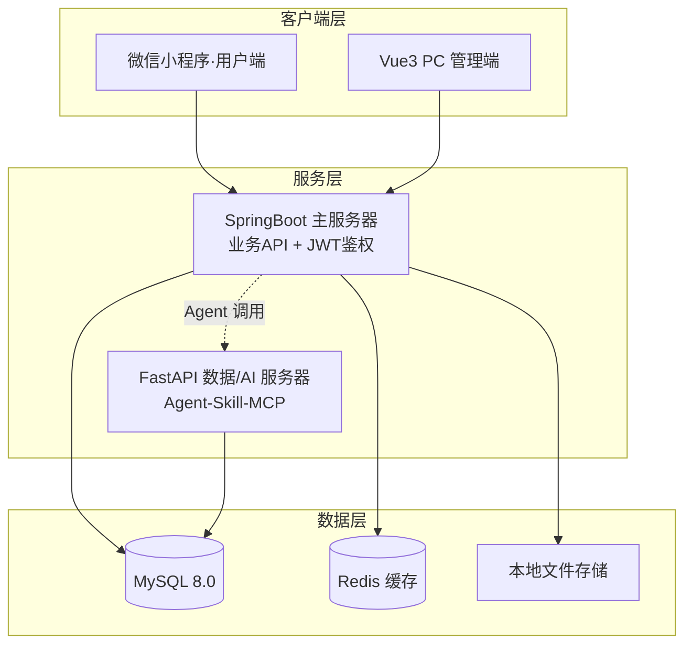

# 校园二手物品交易平台

> 东南大学 计算机科学与技术专业 · 软件开发综合课程设计（B09P0090）
> 小组成员：张雨薇（组长）、万佰鑫、周子航

面向校园场景的二手物品交易系统：学生通过**微信小程序**浏览、发布、购买二手物品，管理员通过 **PC 管理端**完成商品审核与用户管理，并接入 **Agent-Skill-MCP** 智能能力，用自然语言完成商品查询、发布辅助与订单查询。

## 功能总览

| 模块 | 负责人 | 核心能力 |
|---|---|---|
| 用户及权限 | 张雨薇 | 手机号+验证码注册、登录/找回密码、JWT 鉴权、RBAC 三级权限（游客/普通用户/平台管理员/Agent 服务账号）、管理员封禁与操作日志 |
| 商品发布 | 万佰鑫 | 商品发布/编辑/下架（状态机：草稿→待审核→在售→已下架/已售出）、分类、多图上传、库存、违规审核 |
| 购物交易 | 周子航 | 购物车、订单（待支付→已支付→已完成/已取消）、模拟支付、超时取消、交易记录 |
| Agent-Skill-MCP | 周子航（方案）/张雨薇（集成） | SK-001 商品查询、SK-002 发布辅助、SK-003 订单查询；独立服务账号鉴权、越权拦截、操作留痕 |

## 系统架构



## 技术栈

| 层 | 选型 |
|---|---|
| 用户端 | 微信小程序原生（WXML/WXSS/JS） |
| 管理端 | Vue3 + Vite + Element Plus |
| 主服务 | Java 17 + SpringBoot 3 + MyBatis-Plus + JWT |
| 数据/AI 服务 | Python 3.11 + FastAPI + Pydantic + SQLAlchemy |
| 数据库 | MySQL 8.0（InnoDB，utf8mb4_unicode_ci） |
| 缓存 | Redis（验证码、会话、热门商品） |
| 文件 | 本地磁盘存储商品图片 |

## 仓库结构

```
├── DESIGN.md                    # 设计基线（单一事实来源：架构/RBAC/数据表/Skill清单/接口基线）
├── 软件需求分析报告.md           # 需求文档（九章节单文件，课程交付物）
├── CONTRIBUTING.md              # Git 团队协作规约
├── CHANGELOG.md                 # 变更历史（逐条对应 git log）
├── 工作日志.md                   # 三人工作汇总（阶段评审会议用）
├── report/                      # 个人工作记录
├── design/                      # 设计文档（接口规范总则、db/api 分模块、开源预调研）
├── prototype/                   # 页面原型（纯静态 HTML，index.html 为导航入口）
├── server-springboot/           # 主服务工程规划与环境准备
├── server-fastapi/              # 数据/AI 服务工程规划与环境准备
├── miniprogram/                 # 小程序工程规划与环境准备
├── admin-web/                   # 管理端工程规划与环境准备
└── tools/                       # 阶段校验脚本（validate_report.py / validate_phase2.py）
```

## 快速开始

- **查看原型**：浏览器直接打开 `prototype/index.html`，从导航进入全部 16 个页面，可完整走通"注册→登录→发布→浏览→购物车→下单→模拟支付"页面流转。
- **开发环境准备**：各端依赖与启动步骤见 `server-springboot/README.md`、`server-fastapi/README.md`、`miniprogram/README.md`、`admin-web/README.md`。
- **设计对齐**：所有设计与开发以 `DESIGN.md` 为准，接口遵循 `design/接口规范总则.md`（统一 `/api/v1` 前缀、`{code, msg, data}` 返回、JWT 鉴权）。

## Git 协作（摘要）

- 分支：`main`（稳定发布，仅经 develop 合入）→ `develop`（开发主干）→ `feature/模块名-姓名缩写`（个人开发分支）。
- 提交：`[模块名] 前缀：描述`，前缀 feat/fix/docs/refactor；小步提交，先更新再提交再推送。
- 红线：禁止直接 push main；严禁密钥/密码入库。完整规约见 `CONTRIBUTING.md`。

## 质量校验

```bash
python3 tools/validate_report.py    # 需求文档结构与条目校验
python3 tools/validate_phase2.py    # 原型/数据库/接口文档/密钥校验
```

合并进 develop 前须全部通过，结果记录于 `CHANGELOG.md`。

## 团队与里程碑

| 节点 | 内容 |
|---|---|
| 10-15 | 《软件需求分析报告》提交老师 |
| 10-22 | 原型交付包提交老师 |
| 课次 15 | Agent 基座 / Skill / MCP 集成开发与专项测试 |
| 期末 | 原型验收与答辩、课程设计报告 |
