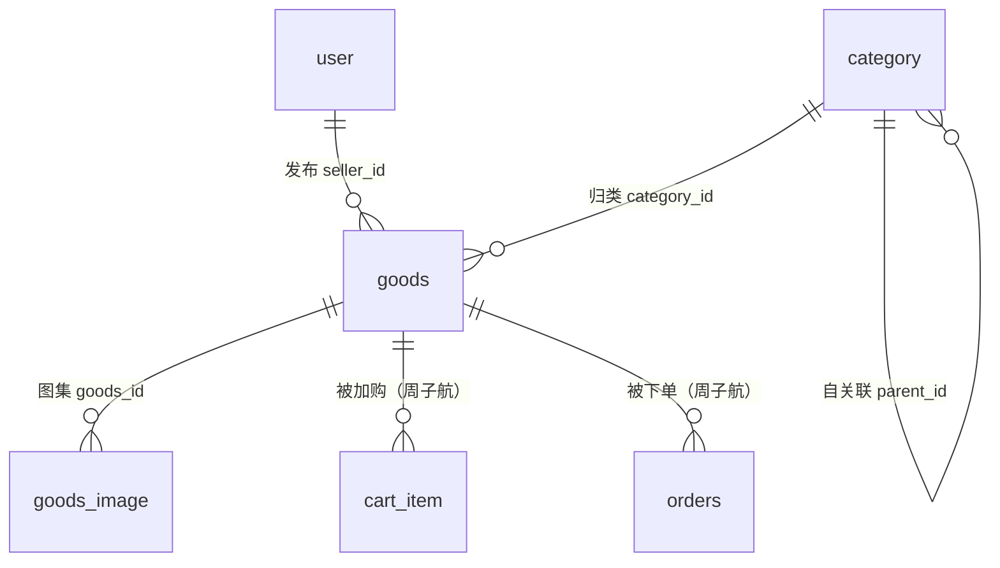

# 数据库表设计 · 商品发布模块（万佰鑫）

> **初稿 · 待课次4校准**
> 东南大学 计算机科学与技术专业 · 软件开发综合课程设计 ｜ 小组
> 依据：DESIGN.md §6（v1.1 修订：goods.status 对齐 report/05 状态机，新增 off_shelf_reason；分类初始数据 seed 约定）、report/05-商品发布模块需求.md
> 范围：`category`、`goods`、`goods_image` 三张表。`user` 表见 db-用户及权限.md（张雨薇）。

## 1. 表关系总览

- `goods.seller_id → user.id`：卖家，逻辑外键（应用层校验，不建物理外键，便于分表与性能）。
- `goods.category_id → category.id`：必须挂到二级分类（`category.parent_id != 0` 的节点）。
- `category.parent_id → category.id`：自关联，`0` 表示一级分类。
- `goods_image.goods_id → goods.id`：商品图集，建议物理外键 `ON DELETE CASCADE`（商品删除则图集无意义）。
- 下游引用（不在本模块建表）：`cart_item.goods_id`、`orders.goods_id` 由周子航在交易表设计中引用。

## 2. 表详细设计

### 2.1 category（分类表）

| 字段名 | 类型 | 约束 | 说明 |
|---|---|---|---|
| id | BIGINT UNSIGNED | PK, AUTO_INCREMENT | 分类ID |
| name | VARCHAR(20) | NOT NULL | 分类名称（同层级内唯一） |
| parent_id | BIGINT UNSIGNED | NOT NULL DEFAULT 0 | 父分类ID；0=一级分类 |
| sort | INT | NOT NULL DEFAULT 0 | 排序值，越小越靠前 |
| is_active | TINYINT(1) | NOT NULL DEFAULT 1 | 是否启用；0=停用（管理端维护分类为可选功能时使用） |
| create_time | DATETIME | NOT NULL DEFAULT CURRENT_TIMESTAMP | 创建时间 |

- 索引：`UNIQUE KEY uk_parent_name(parent_id, name)`（同级不重名）；`KEY idx_parent(parent_id)`（级联选择按父查子）。
- 初始数据：遵循 DESIGN.md §6 分类初始数据约定——建库 seed SQL 预置 6 个一级分类（教材书籍、数码电子、生活用品、运动户外、服饰鞋包、美妆个护，`parent_id=0`）及各下一级二级分类；管理端维护分类列为可选功能。
- 对应：DESIGN.md §6 `category(id, name, parent_id, sort)`，is_active 为可选功能预留扩展；report/05 §二 分类约定。

### 2.2 goods（商品表）

| 字段名 | 类型 | 约束 | 说明 |
|---|---|---|---|
| id | BIGINT UNSIGNED | PK, AUTO_INCREMENT | 商品ID |
| seller_id | BIGINT UNSIGNED | NOT NULL | 卖家用户ID → user.id |
| category_id | BIGINT UNSIGNED | NOT NULL | 分类ID → category.id（须为二级分类） |
| title | VARCHAR(40) | NOT NULL | 标题，5-40字（report/05 条目1） |
| description | VARCHAR(500) | NOT NULL | 描述，10-500字 |
| price | DECIMAL(6,2) | NOT NULL | 价格 0.01-9999.00（report/05 条目1） |
| negotiable | TINYINT(1) | NOT NULL DEFAULT 0 | 是否可议价（report/05 4.1 议价开关） |
| stock | INT | NOT NULL DEFAULT 1 | 库存 1-99；0 表示已售罄自动不可购买（report/05 条目2） |
| status | TINYINT UNSIGNED | NOT NULL DEFAULT 1 | 状态：0草稿/1待审核/2在售/3已下架/4已售出（对齐 report/05 §三状态机） |
| off_shelf_reason | VARCHAR(200) | NULL | 下架原因；管理员下架违规时必填（10-200字），卖家可见（report/05 条目7） |
| create_time | DATETIME | NOT NULL DEFAULT CURRENT_TIMESTAMP | 发布提交时间 |
| update_time | DATETIME | NOT NULL DEFAULT CURRENT_TIMESTAMP ON UPDATE CURRENT_TIMESTAMP | 最后编辑时间 |

- status 枚举与流转（对齐 report/05 §三、DESIGN.md v1.1）：发布/重新上架→待审核(1)；审核通过→在售(2)；卖家主动下架或管理员下架违规→已下架(3)；订单支付成功扣减库存→已售出(4)；管理员驳回→草稿(0)。
- 索引：
  - `KEY idx_category_status(category_id, status)`：列表页按分类+在售筛选（report/05 条目6）。
  - `KEY idx_seller(seller_id)`：我的商品列表（report/05 条目9）。
  - `KEY idx_status_create(status, create_time)`：在售商品按时间倒序的分页列表。
  - 关键词搜索第一版用 `LIKE '%kw%'` 匹配 title/description（DESIGN.md §1 明确不做 ES），不建全文索引，`idx_category_status` 先收窄结果集。
- 对应：DESIGN.md §6 `goods`（含 v1.1 新增 off_shelf_reason）；report/05 条目1-9、§三状态机；US-03/US-04/US-06/US-07。

### 2.3 goods_image（商品图片表）

| 字段名 | 类型 | 约束 | 说明 |
|---|---|---|---|
| id | BIGINT UNSIGNED | PK, AUTO_INCREMENT | 图片ID |
| goods_id | BIGINT UNSIGNED | NOT NULL | 所属商品 → goods.id |
| url | VARCHAR(255) | NOT NULL | 图片相对 URL（本地文件存储，Nginx/静态映射访问） |
| sort | TINYINT UNSIGNED | NOT NULL DEFAULT 0 | 排序；0=主图（第一张），对应 report/05 条目3 |
| create_time | DATETIME | NOT NULL DEFAULT CURRENT_TIMESTAMP | 上传时间 |

- 约束：每个商品最多 6 张（应用层校验，report/05 条目3）；单张 ≤5MB，仅 jpg/png/webp（接口规范总则 §6）。
- 索引：`KEY idx_goods(goods_id, sort)`（详情页按序取图）；`UNIQUE KEY uk_goods_sort(goods_id, sort)` 防止同商品排序冲突。
- 物理外键：`FOREIGN KEY (goods_id) REFERENCES goods(id) ON DELETE CASCADE`。
- 对应：DESIGN.md §6 `goods_image(id, goods_id, url, sort)`；report/05 条目3、4.1 图片上传输入项。

## 3. 与需求条目的映射

| report/05 功能条目 | 落到本模块表 |
|---|---|
| 条目1 发布商品（标题/描述/价格/分类/图片） | goods.title/description/price/category_id + goods_image；提交后 status=待审核 |
| 条目2 库存 | goods.stock（1-99，0=售罄不可购买） |
| 条目3 多图上传 | goods_image（≤6张，sort=0 主图） |
| 条目4 编辑商品 | goods 各可编辑字段 + update_time（价格冷却期在应用层实现） |
| 条目5 主动下架 | goods.status=已下架 |
| 条目6 浏览搜索 | goods.idx_category_status + LIKE 搜索 |
| 条目7 管理员下架违规 | goods.status=已下架 + off_shelf_reason 必填；留痕写 admin_op_log（张雨薇表） |
| 条目8 审核通过/驳回 | goods.status 待审核→在售 / →草稿 |
| 条目9 我的商品列表 | goods.idx_seller + status 筛选，展示 off_shelf_reason |
