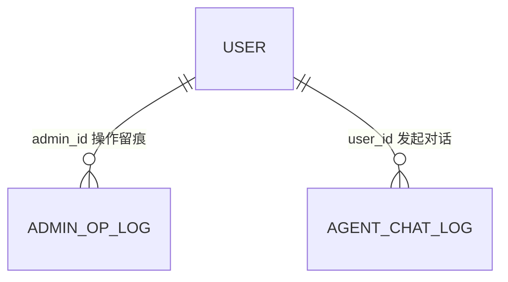

# 数据库表设计初稿 · 用户及权限模块

> 东南大学 计算机科学与技术专业 · 软件开发综合课程设计 ｜ 负责人：张雨薇
> **初稿 · 待课次4校准**。与 DESIGN.md §6 对齐；类型/索引细节为初稿，数据库设计定稿以课次 4 校准为准。

## 表清单与外键关系

| 表 | 说明 | 外键 |
|---|---|---|
| user | 用户账号（含角色与状态） | 无（被 goods.seller_id、orders.buyer_id 等引用） |
| admin_op_log | 管理员关键操作日志 | admin_id → user.id（RESTRICT，仅角色=管理员） |
| agent_chat_log | Agent 调用留痕 | user_id → user.id（SET NULL：发起用户可注销） |

关系图（mermaid）：

图：用户及权限模块 ER 关系（初稿）

## 1. user（用户表）

| 字段名 | 类型 | 约束 | 说明 |
|---|---|---|---|
| id | BIGINT UNSIGNED | PK, AUTO_INCREMENT | 用户ID |
| phone | CHAR(11) | UNIQUE, NOT NULL | 手机号（账号标识，全平台唯一，注册后不可改） |
| password_hash | VARCHAR(64) | NOT NULL | 密码哈希（bcrypt/argon2，严禁明文） |
| nickname | VARCHAR(20) | NOT NULL, DEFAULT '' | 昵称（2-20 字符，默认"用户+手机号后四位"） |
| avatar | VARCHAR(255) | DEFAULT NULL | 头像 URL（jpg/png，≤2MB，本地文件存储相对路径） |
| role | ENUM('USER','ADMIN') | NOT NULL, DEFAULT 'USER' | 角色（RBAC：用户→角色→权限；agent-svc 走服务账号不入本表角色枚举） |
| status | ENUM('ACTIVE','BANNED') | NOT NULL, DEFAULT 'ACTIVE' | 账号状态（封禁后登录 423，JWT 失效，在售商品自动下架） |
| create_time | DATETIME | NOT NULL, DEFAULT CURRENT_TIMESTAMP | 注册时间 |

索引：`uk_phone(phone)`；`idx_status(role, status)`（管理端按角色+状态筛选）。

对应关系：DESIGN.md §6 `user` 行；report/04 注册条目（手机号唯一）、RBAC 对照表、封禁/解封条目。

## 2. admin_op_log（管理员操作日志表）

| 字段名 | 类型 | 约束 | 说明 |
|---|---|---|---|
| id | BIGINT UNSIGNED | PK, AUTO_INCREMENT | 日志ID |
| admin_id | BIGINT UNSIGNED | NOT NULL, FK→user.id | 操作管理员（角色必须 ADMIN，Service 层校验） |
| action | VARCHAR(32) | NOT NULL | 动作（BAN_USER / UNBAN_USER / OFF_SHELF_GOODS / AUDIT_PASS / AUDIT_REJECT / FORCE_LOGOUT） |
| target_type | VARCHAR(16) | NOT NULL | 目标类型（user / goods / order） |
| target_id | BIGINT UNSIGNED | NOT NULL | 目标ID |
| detail | VARCHAR(200) | NOT NULL | 详情（封禁/下架原因 1-200 字，对目标用户可见） |
| create_time | DATETIME | NOT NULL, DEFAULT CURRENT_TIMESTAMP | 操作时间 |

索引：`idx_target(target_type, target_id)`；`idx_admin_time(admin_id, create_time)`。

对应关系：DESIGN.md §6 `admin_op_log` 行；report/04 操作日志条目（只读、按时间倒序分页、不可修改删除）。

## 3. agent_chat_log（Agent 对话留痕表）

| 字段名 | 类型 | 约束 | 说明 |
|---|---|---|---|
| id | BIGINT UNSIGNED | PK, AUTO_INCREMENT | 记录ID |
| user_id | BIGINT UNSIGNED | DEFAULT NULL, FK→user.id | 发起用户（匿名/服务调用可空，置 NULL） |
| prompt | VARCHAR(1000) | NOT NULL | 用户自然语言输入原文 |
| response | VARCHAR(2000) | DEFAULT NULL | Agent 响应摘要 |
| skill_name | VARCHAR(32) | DEFAULT NULL | 命中 Skill（SK-001/002/003，未命中为 NULL） |
| status | ENUM('OK','DENIED','ERROR') | NOT NULL | 结果（DENIED=越权拦截 4003，必须留痕） |
| create_time | DATETIME | NOT NULL, DEFAULT CURRENT_TIMESTAMP | 时间 |

索引：`idx_user_time(user_id, create_time)`；`idx_skill_status(skill_name, status)`。

对应关系：DESIGN.md §6 `agent_chat_log` 行、§7 安全约束（操作留痕）；report/09 Agent-Skill-MCP 专项。

## 4. 会话与验证码（Redis，不入库）

- `captcha:{phone}`：6 位验证码，TTL 5 分钟；获取间隔 60s（`captcha:lock:{phone}` TTL 60s）。
- `session:{uid}`：JWT 会话白名单，TTL 2 小时；封禁/退出/改密时 DEL。
- `login:fail:{phone}`：密码错误计数，TTL 30 分钟，≥5 次锁定。
