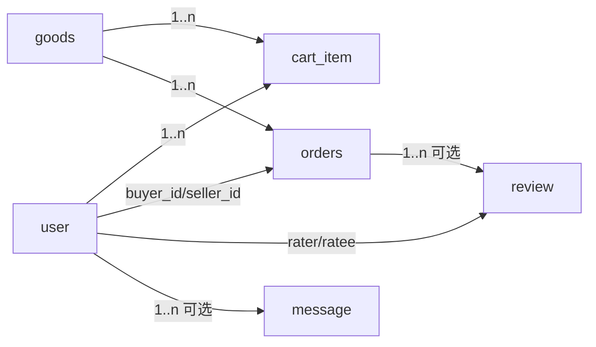

# 数据库表初稿 · 购物交易模块

> 东南大学 计算机科学与技术专业 · 软件开发综合课程设计 ｜ 小组
> **初稿 · 待课次4校准**
> 负责人：周子航 ｜ 对应 DESIGN.md §6（`cart_item`、`orders`、`review`、`message`）与 report/06 购物交易模块需求。
> 通用约定：MySQL 8.0、InnoDB、utf8mb4_unicode_ci；主键一律 `id BIGINT UNSIGNED AUTO_INCREMENT`；时间字段 `DATETIME`（服务器时区 UTC+8）；软删除不做（订单以状态表达终结）。

## 1. cart_item（购物车条目）

对应 DESIGN.md §6 `cart_item`；支撑 report/06 条目"加入购物车 / 调整数量或移除"。

| 字段名 | 类型 | 约束 | 说明 |
|---|---|---|---|
| id | BIGINT UNSIGNED | PK, AUTO_INCREMENT | 主键 |
| user_id | BIGINT UNSIGNED | NOT NULL, FK→user.id | 所属买家（登录态解析，防越权） |
| goods_id | BIGINT UNSIGNED | NOT NULL, FK→goods.id | 商品 id；同一用户同商品仅一条记录，重复加购累加 num |
| num | INT | NOT NULL, 1≤num≤99（上限取商品当前 stock） | 购买数量；步进器调整时后端二次校验 |
| create_time | DATETIME | NOT NULL DEFAULT CURRENT_TIMESTAMP | 首次加入时间（基线补充字段） |
| update_time | DATETIME | NOT NULL DEFAULT CURRENT_TIMESTAMP ON UPDATE CURRENT_TIMESTAMP | 最近调整时间（基线补充字段） |

**索引**：`UNIQUE KEY uk_user_goods(user_id, goods_id)`（防重复行）；`KEY idx_user(user_id)`（列表查询，可被联合唯一索引最左前缀覆盖，按课次4实测定夺）。

## 2. orders（订单）

对应 DESIGN.md §6 `orders`；支撑 report/06 条目"提交订单 / 重复下单校验 / 模拟支付 / 取消订单 / 确认收货 / 查看订单"。基线字段之外补充价格快照说明与时间节点字段。

| 字段名 | 类型 | 约束 | 说明 |
|---|---|---|---|
| id | BIGINT UNSIGNED | PK, AUTO_INCREMENT | 主键 |
| order_no | VARCHAR(20) | NOT NULL, UNIQUE | 业务订单号，规则"日期(yyyyMMdd)+当日序号(6位)"，如 20261014000001 |
| buyer_id | BIGINT UNSIGNED | NOT NULL, FK→user.id | 买家；查询与属主校验依据 |
| seller_id | BIGINT UNSIGNED | NOT NULL, FK→user.id | 卖家，下单时从 goods.seller_id 冗余（基线补充；供"我卖出的"侧查询，避免联表） |
| goods_id | BIGINT UNSIGNED | NOT NULL, FK→goods.id | 商品 id；第一版一单一商品（购物车多件→拆单） |
| deal_price | DECIMAL(10,2) | NOT NULL, 0.01≤price≤9999.99 | 成交价快照＝下单时刻 goods.price，后续卖家改价不影响已生成订单 |
| num | INT | NOT NULL, ≥1 | 购买数量（基线补充；与 deal_price 共同确定实付额） |
| remark | VARCHAR(100) | NULL | 收货备注（确认订单页输入项，基线补充） |
| status | TINYINT | NOT NULL, 0=待支付/1=已支付/2=已完成/3=已取消 | 状态机：0→1→2 与 0→3 两条合法路径，非法迁移由 Service 层拒绝（见 api 文档"确认收货"幂等说明） |
| pay_time | DATETIME | NULL | 模拟支付成功时间（基线补充） |
| finish_time | DATETIME | NULL | 确认收货时间（基线补充） |
| cancel_time | DATETIME | NULL | 取消时间（基线补充） |
| request_id | VARCHAR(64) | NOT NULL | 客户端幂等键（总则 §6），防重复提交下单（基线补充） |
| create_time | DATETIME | NOT NULL DEFAULT CURRENT_TIMESTAMP | 下单时间 |

**索引**：`UNIQUE KEY uk_order_no(order_no)`；`UNIQUE KEY uk_request(request_id)`（幂等）；`KEY idx_buyer_status(buyer_id, status, create_time)`（我的订单按状态分 Tab 倒序）；`KEY idx_seller(seller_id, create_time)`（可选，供卖家侧视图）。

**超时取消**：30 分钟未支付自动取消由定时任务扫描 `status=0 AND create_time < NOW()-30min` 实现，取消时若商品仍在售则不额外处理（第一版下单不锁库存，支付时才扣减；扣减失败返回 409——待课次4校准是否改为下单即锁库存）。

## 3. review（交易评价）【可选模块】

对应 DESIGN.md §6 `review`【可选】；作为"已完成"订单的后续数据。

| 字段名 | 类型 | 约束 | 说明 |
|---|---|---|---|
| id | BIGINT UNSIGNED | PK, AUTO_INCREMENT | 主键 |
| order_id | BIGINT UNSIGNED | NOT NULL, FK→orders.id | 仅"已完成"订单可评价 |
| rater_id | BIGINT UNSIGNED | NOT NULL, FK→user.id | 评价人（买家或卖家） |
| ratee_id | BIGINT UNSIGNED | NOT NULL, FK→user.id | 被评价人；与 rater 必须分属订单买卖双方 |
| score | TINYINT | NOT NULL, 1≤score≤5 | 星级 |
| content | VARCHAR(200) | NOT NULL | 评价文字 |
| create_time | DATETIME | NOT NULL DEFAULT CURRENT_TIMESTAMP | 评价时间 |

**索引**：`UNIQUE KEY uk_order_rater(order_id, rater_id)`（一单一方一评）；`KEY idx_ratee(ratee_id, create_time)`（个人主页信誉展示）。

## 4. message（站内消息）【可选模块】

对应 DESIGN.md §6 `message`【可选】；交易侧用于订单状态变更提醒（下单/支付成功/超时取消等）。

| 字段名 | 类型 | 约束 | 说明 |
|---|---|---|---|
| id | BIGINT UNSIGNED | PK, AUTO_INCREMENT | 主键 |
| user_id | BIGINT UNSIGNED | NOT NULL, FK→user.id | 接收人 |
| type | VARCHAR(20) | NOT NULL | 消息类型：order_created/order_paid/order_canceled/system |
| content | VARCHAR(255) | NOT NULL | 消息内容（含订单号，可直接点击跳订单详情） |
| is_read | TINYINT(1) | NOT NULL DEFAULT 0 | 0 未读 / 1 已读 |
| create_time | DATETIME | NOT NULL DEFAULT CURRENT_TIMESTAMP | 产生时间 |

**索引**：`KEY idx_user_read(user_id, is_read, create_time)`（未读列表与红点计数）。

## 5. 外键与跨模块关系

- `cart_item`/`orders`/`review`/`message` 的用户与商品外键分别指向 用户及权限模块 `user` 表、商品发布模块 `goods` 表；交易侧不冗余用户昵称等可变信息，展示时联查或走缓存。
- 订单状态流转时间线由 `create_time/pay_time/finish_time/cancel_time` 四个时间节点拼装，不另建流水表（第一版从简，待课次4校准）。
