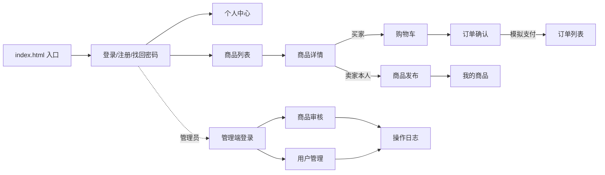

# 校园二手物品交易平台 · 原型说明

> 东南大学 计算机科学与技术专业 · 软件开发综合课程设计 ｜ 2026-10-14
> 原型为纯静态 HTML+内联 CSS，**不做视觉美化**，重点表达页面流转与输入项（`原型交付包.zip` 于 10-22 前由组长单独发老师）。

## 页面清单（16 页）

| 页面 | 文件 | 负责人 | 需求来源 |
|---|---|---|---|
| 原型入口 | index.html | 张雨薇 | 导航壳 |
| 登录页 | pages/auth-login.html | 张雨薇 | report/04 登录条目 |
| 注册页 | pages/auth-register.html | 张雨薇 | report/04 注册条目 |
| 找回密码页 | pages/auth-findpwd.html | 张雨薇 | report/04 找回密码条目 |
| 个人中心 | pages/auth-profile.html | 张雨薇 | report/04 个人中心说明 |
| 管理端登录 | pages/admin-login.html | 张雨薇 | report/04 登录条目 |
| 商品审核 | pages/admin-goods-audit.html | 张雨薇 | report/05 管理员审核/下架条目 |
| 用户管理 | pages/admin-user-manage.html | 张雨薇 | report/04 封禁/解封条目 |
| 操作日志 | pages/admin-oplog.html | 张雨薇 | report/04 操作日志条目 |
| 商品列表 | pages/goods-list.html | 万佰鑫 | report/05 浏览搜索条目 |
| 商品详情 | pages/goods-detail.html | 万佰鑫 | report/05 详情页说明 |
| 商品发布 | pages/goods-publish.html | 万佰鑫 | report/05 发布条目 |
| 我的商品 | pages/goods-mine.html | 万佰鑫 | report/05 我的商品页说明 |
| 购物车 | pages/cart.html | 周子航 | report/06 购物车条目 |
| 订单确认 | pages/order-confirm.html | 周子航 | report/06 下单/模拟支付条目 |
| 订单列表 | pages/order-list.html | 周子航 | report/06 订单状态机 |

## 流转总图

图：原型页面流转总图（与 report/04 §4.4、report/05 §4.4、report/06 页面流转一致）

## 查看方式

浏览器直接打开 `index.html`，可从入口点通"登录→浏览→购物车→下单→模拟支付→订单列表"全流程与发布、管理端路径。
