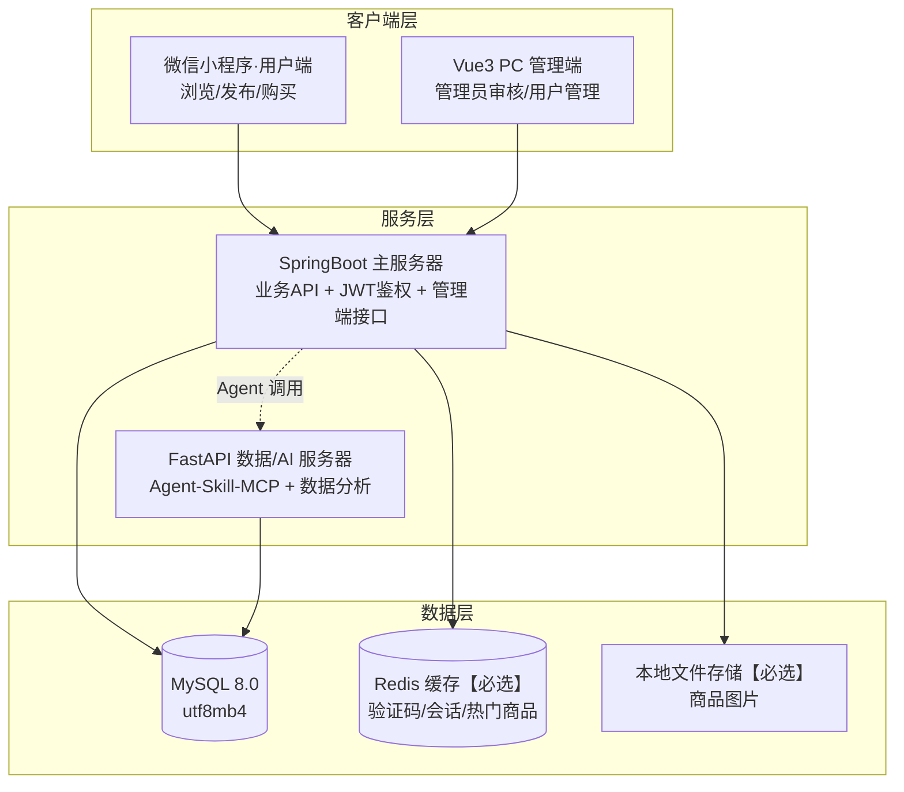

# 二、项目背景与系统概述

> 对应《软件需求分析报告》章节二。设计基线以 DESIGN.md 为单一事实来源，本文与其冲突时以 DESIGN.md 为准。

## 1. 项目背景与痛点

高校校园内学生二手物品流转需求长期旺盛：毕业季书籍、电器、自行车集中处理，新生入学又恰好需要这些低价实用物品。目前的现状与痛点：

- **渠道散**：二手交易散落在校园墙 QQ 群、微信群、表白墙帖子中，信息碎片化，卖家发布后难以被精准检索，买家找一件"大二高数教材"要翻几百条群聊记录。
- **信任弱**：群聊交易无平台背书，买卖双方互不了解；出现货不对板、爽约后没有投诉与管理渠道，管理员无法下架违规信息。
- **管理缺**：校园群管理员靠人工删帖，无账号封禁机制，违规发布者换个号即可继续；管理员的关键操作也没有留痕，无法追责。
- **沟通低效**：群聊里问价、砍价、约面交的消息互相淹没，买家无法跟踪自己感兴趣的多个商品。

本系统将上述散乱流程收拢为一个平台：**小程序端面向普通学生完成浏览、发布、购物车、下单与模拟支付；PC 管理端面向平台管理员完成商品审核与用户账号管理**，并以 RBAC 权限体系与操作日志保障平台可管理、可追责。

## 2. 系统拓扑

系统采用前后端分离架构，双端（小程序用户端 + PC 管理端）共用同一套主服务 API；同时为课次 15 的 Agent 集成预留 FastAPI 数据/AI 服务器链路。

图 2-1 系统拓扑图（与 DESIGN.md §2 一致）

- 前后端分离：小程序面向普通用户，PC 管理端面向平台管理员；
- Agent 链路：用户自然语言 → FastAPI Agent → MCP 报文 → Skill 鉴权 → 转发业务 API（详见 report/09 专项小节）。

## 3. 技术栈说明

| 层 | 选型 | 说明 |
|---|---|---|
| 用户端 | 微信小程序原生（WXML/WXSS/JS） | 面向学生，校园场景天然适合小程序，无需安装 |
| 管理端 | Vue3 + Vite + Element Plus | 面向平台管理员的 PC 端 |
| 主服务 | Java 17 + SpringBoot 3 + MyBatis-Plus + JWT | 业务 API + JWT 鉴权 + 管理端接口，统一前缀 `/api/v1/`，返回 `{code, msg, data}` |
| 数据/AI 服务 | Python 3.11 + FastAPI + Pydantic + SQLAlchemy | Agent-Skill-MCP 子系统与数据分析 |
| 数据库 | MySQL 8.0（InnoDB，utf8mb4_unicode_ci） | 核心业务数据 |
| 缓存 | Redis【必选】 | 验证码、会话、热门商品列表 |
| 文件系统 | 本地磁盘存储商品图片，Nginx/静态映射【必选】 | 商品图片上传与访问 |
| 搜索 | MySQL LIKE/索引 | 第一版不引入 ES（DESIGN.md §1 裁剪项） |

## 4. 系统边界（第一版不做清单）

明确**不在本系统第一版范围内**的事项（DESIGN.md §1 三级裁剪），防止需求蔓延：

| 不做项 | 代替方案 |
|---|---|
| 即时聊天 | 面交自约，站内消息系统列为可选模块 |
| 复杂风控 | 基础账号封禁/解封 + 操作日志兜底 |
| 第三方真实支付 | 模拟支付（订单状态流转到"已支付"） |
| ES 搜索 | MySQL LIKE/索引关键词检索 |
| 评价体系、消息通知 | 列为可选模块，时间允许再做 |

任何新增功能须小组共同评审、记录变更原因并更新本文档。
