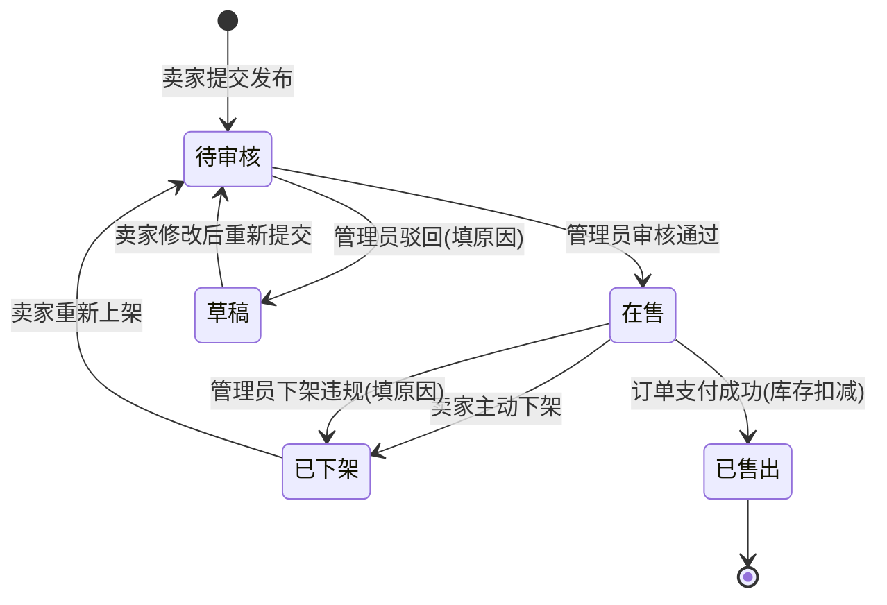
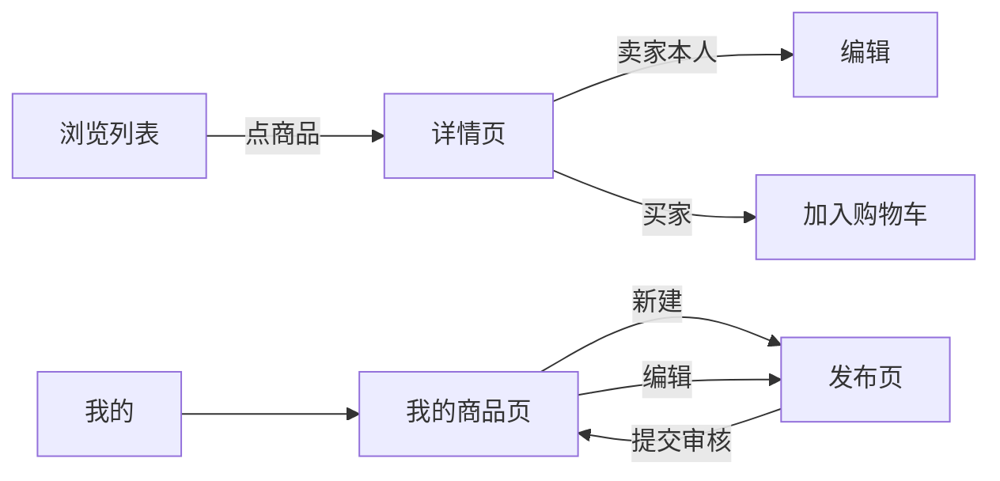

# 商品发布模块需求（万佰鑫）

> 交付物：软件需求分析报告 · 第 5 节素材
> 东南大学 计算机科学与技术专业 · 软件开发综合课程设计
> 项目：校园二手物品交易平台 ｜ 模块：商品发布（商品 CRUD、分类、多图上传、库存、上下架、审核流）
> 对应 DESIGN.md：§4 角色权限、§5 模块分工、§6 数据表 `goods`/`goods_image`/`category`、US-03/US-06/US-07
> 负责人：万佰鑫 ｜ 日期：2026-10-14

## 一、功能需求清单

格式约定：`[角色] 动词+对象，约束条件：...`。

- [卖家] 可以填写标题、描述、价格、分类并上传 1-6 张实拍图发布商品，约束条件：标题 5-40 字、描述 10-500 字、价格 0.01-9999 元且保留两位小数、必须选择一个二级分类，提交后商品进入"待审核"状态，审核通过才对买家可见。
- [卖家] 可以为商品设置库存数量，约束条件：库存为 1-99 的整数，单个商品每次最多可发布 99 件（限量转卖），库存为 0 时商品自动变为不可购买状态。
- [卖家] 可以为同一商品上传多张图片，约束条件：单张图片不超过 5MB、支持 jpg/png/webp 格式、每个商品最多 6 张，第一张默认为主图，图片按上传顺序排序。
- [卖家] 可以编辑自己在售的商品信息，约束条件：仅能编辑自己发布的商品；已售出或已被管理员下架的商品不可编辑；修改价格后 10 分钟内该商品暂停被下单，防止价格争议。
- [卖家] 可以主动下架自己发布的商品，约束条件：仅"在售"状态的商品可主动下架；下架后商品立即从买家浏览列表消失，但历史订单不受影响。
- [普通用户] 可以按分类与关键词浏览搜索商品，约束条件：游客即可浏览"在售"状态的商品；搜索范围含标题与描述，使用 MySQL LIKE/索引实现（第一版不做 ES）；待审核、已下架的商品不出现在结果中。
- [平台管理员] 可以下架任意用户发布的违规商品，约束条件：下架时必须填写下架原因（10-200 字），原因对卖家可见；本次操作写入管理员操作日志（`admin_op_log`）。
- [平台管理员] 可以审核待审核商品并决定通过或驳回，约束条件：驳回时填写驳回原因（如标题含违规词、图片与描述不符）；驳回后商品回到"草稿"状态，卖家可修改后重新提交。
- [卖家] 可以查看自己全部商品的状态列表（我的商品页），约束条件：列表按创建时间倒序，展示状态标签（在售/待审核/已下架/已售出）与被下架原因；支持按状态筛选。

## 二、商品分类约定（第一版）

一级分类固定四类，二级分类可由管理员维护（`category` 表，`parent_id` 支持层级）：

| 一级分类 | 二级分类示例 |
|---|---|
| 教材书籍 | 专业课教材、考研考公、课外读物 |
| 数码电子 | 手机、电脑、耳机、平板 |
| 生活用品 | 台灯、收纳、小家电 |
| 运动出行 | 自行车、球拍、健身器材 |

约束：发布商品必须挂到二级分类节点；一级分类仅用于导航。

## 三、商品状态流转

## 四、本模块原型页面说明

原型重点在**页面流转与输入项**，不追求 UI 美化（线框即可，10-22 前随原型 zip 提交）。

### 4.1 发布页（普通用户）

- **进入方式**：底部导航"发布"按钮，未登录则跳转登录页。
- **输入项**：
  - 标题（必填，字数计数器 5-40）
  - 分类（一级 → 二级级联选择器，必填）
  - 价格（数字键盘，必填）+ 是否可议价开关
  - 库存（默认 1，步进器 1-99）
  - 商品描述（多行文本，必填）
  - 图片上传（九宫格上传控件，最多 6 张，第一张标记"主图"）
- **操作流转**：填写完成 → 点"提交审核" → 弹窗二次确认 → 成功提示"已提交，等待管理员审核" → 跳转"我的商品"页。
- **异常分支**：必填缺失/格式错误 → 对应输入框红字提示，不跳转；图片上传中禁止提交。

### 4.2 商品详情页（游客/买家）

- **进入方式**：浏览列表点入任意"在售"商品。
- **展示项**：主图轮播 + 缩略图列表、标题、价格、分类路径、库存、卖家昵称、发布时间、商品描述全文。
- **操作流转**：
  - 游客点"加入购物车" → 提示"请先登录" → 跳转登录页；
  - 买家点"加入购物车" → 成功后角标 +1，可继续浏览；
  - 卖家本人查看自己商品时，按钮区替换为"编辑 / 下架"，不显示购买按钮。
- **输入项**：无（只读页 + 数量选择弹层）。

### 4.3 我的商品页（卖家）

- **进入方式**："我的"页 → "我的商品"入口。
- **展示项**：按状态筛选的 Tab（全部/在售/待审核/已下架/已售出），每条商品卡片显示主图缩略、标题、价格、库存、状态标签；被管理员下架的商品卡片上展示下架原因。
- **操作流转**：
  - 点"编辑" → 复用发布页表单，预填原数据 → 保存 → 状态不变的直接生效；
  - 点"下架" → 弹窗确认"下架后买家将无法看到该商品" → 状态变为已下架；
  - 草稿/已下架商品点"重新上架" → 进入待审核。

### 4.4 页面流转总览

