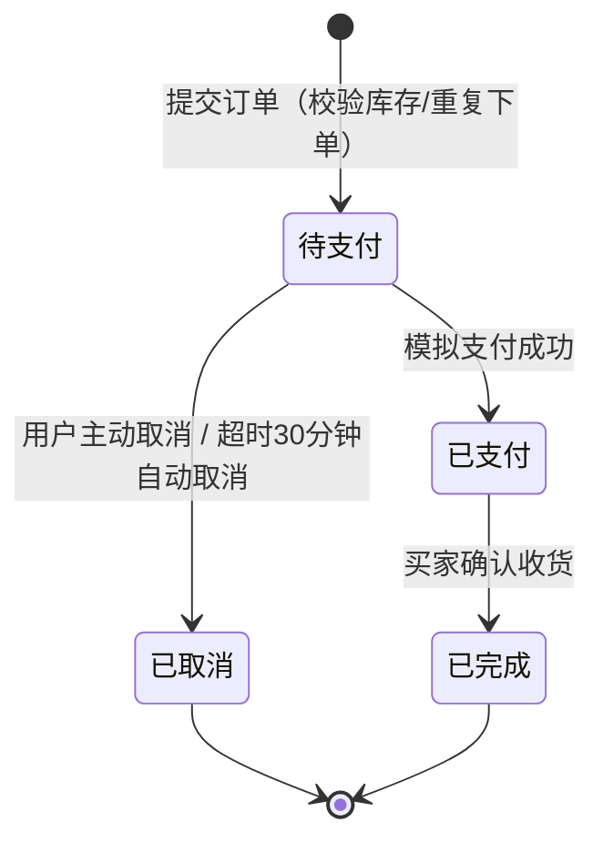

# 06 购物交易模块需求（购物车 / 订单 / 模拟支付）

> 东南大学 计算机科学与技术专业 · 软件开发综合课程设计
> 负责人：周子航｜对应 DESIGN.md §1 必做范围"购物车、订单交易（模拟支付）"、§6 数据表 `cart_item`、`orders`、§9 US-05。
> 本模块覆盖买家从"把商品放进购物车"到"订单终结（已完成/已取消）"的完整闭环。

## 1. 功能需求清单

- [普通用户] 可以将状态为"在售"的商品加入购物车，约束条件：每次点击购买数量默认加 1，同一商品重复加入仅累加数量不生成重复记录，购物车内商品种类上限 20 种。
- [普通用户] 可以调整购物车内商品的购买数量或移除商品，约束条件：购买数量必须在 1 至该商品剩余库存之间，移除操作即时生效且不需二次确认。
- [普通用户] 可以在购物车勾选商品提交订单，约束条件：提交时后端二次校验商品状态仍为"在售"且库存充足，成交价 deal_price 按下单时刻的商品价格快照生成，订单号 order_no 按"日期+当日序号"规则生成且全局唯一。
- [普通用户] 对同一商品重复提交订单时触发重复下单校验，约束条件：同一买家对同一商品存在"待支付"订单时再次下单，系统拦截并提示已存在待支付订单，引导用户选择"前往支付"或"取消原订单后重新下单"。
- [普通用户] 可以对"待支付"订单完成模拟支付，约束条件：支付页展示订单号与应付金额，确认后订单状态由"待支付"变更为"已支付"并记录支付时间，扣减对应商品库存；模拟支付仅在本系统内完成状态变更，不接入真实第三方支付渠道。
- [普通用户] 可以取消未支付的订单，约束条件：仅"待支付"状态允许主动取消，取消后不扣减库存并释放商品回"在售"状态；订单超过 30 分钟未支付由系统定时任务自动取消。
- [普通用户] 可以对"已支付"订单确认收货，约束条件：确认收货后订单状态置为"已完成"，已完成的订单不可再变更状态，作为后续可选评价模块的前置数据。
- [普通用户] 可以查看本人全部订单列表与订单详情，约束条件：订单状态机固定为"待支付→已支付→已完成"或"待支付→已取消"两条路径，任何非法状态跳转（如对已取消订单再支付）一律由后端拒绝并返回业务错误。

## 2. 订单状态流转说明

- 状态变更只允许由后端服务触发，前端不直接修改状态。
- 每次状态变更记录时间节点（下单时间、支付时间、完成/取消时间），供订单详情页展示与对账。

## 3. 本模块原型页面说明

原型阶段共 3 个页面，页面流转：**商品详情页 →（加入购物车）→ 购物车页 →（去结算）→ 确认订单页 →（模拟支付）→ 订单列表页**。

### 3.1 购物车页（cart）

- **入口**：底部 Tab"购物车"、商品详情页"加入购物车"成功后的引导跳转。
- **展示项**：商品图片缩略图、标题、单价、购买数量（可 +/−）、小计金额、复选框。
- **输入项**：数量调整（步进器）、移除商品、全选/单选勾选。
- **操作与流转**：底部常驻"已选合计 + 去结算"按钮；点击"去结算"校验至少勾选 1 件且库存充足，通过后携带选中商品 id 列表跳转确认订单页；点击商品区域可回跳商品详情页。

### 3.2 确认订单页（order-confirm）

- **入口**：购物车页"去结算"。
- **展示项**：收货信息（第一版简化为文本备注，不做地址库）、商品清单、单价快照、数量、合计金额。
- **输入项**：收货备注（选填，≤100 字）、支付方式仅"模拟支付"一项（只读展示）。
- **操作与流转**：点击"提交订单"→ 后端执行库存与重复下单校验 → 校验通过跳转模拟支付确认弹窗（展示订单号、金额）→ 支付成功跳转订单列表页并置顶展示该订单；校验失败在页内 toast 提示原因（如"存在待支付订单"）。

### 3.3 订单列表页（order-list）

- **入口**：个人中心"我的订单"、支付成功跳转。
- **展示项**：按状态分 Tab（全部/待支付/已支付/已完成/已取消），每条订单展示订单号、商品标题、成交价快照、状态、关键时间节点。
- **输入项**：状态 Tab 切换、下拉刷新。
- **操作与流转**："待支付"订单提供"去支付"（复用模拟支付弹窗）与"取消订单"（二次确认）按钮；"已支付"订单提供"确认收货"按钮；点击订单条目进入订单详情查看状态流转时间线。
