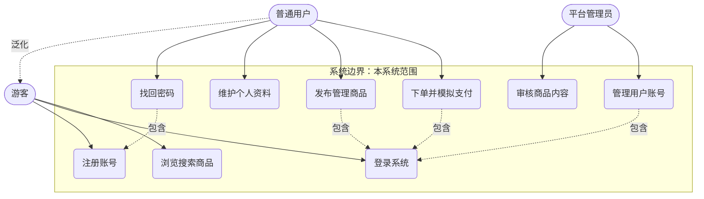

# 用户画像与系统用例图（万佰鑫）

> 交付物：软件需求分析报告 · 第 8 节素材
> 东南大学 计算机科学与技术专业 · 软件开发综合课程设计
> 项目：校园二手物品交易平台（B09P0090 · 小组）
> 依据：DESIGN.md §4 角色与 RBAC 框架（游客 / 普通用户·买卖合一 / 平台管理员）
> 负责人：万佰鑫 ｜ 日期：2026-10-14

## 一、用户画像角色卡片（四要素：背景 / 使用目标 / 痛点 / 典型场景）

### 卡片 1：买家 · 学生小林

| 要素 | 内容 |
|---|---|
| **背景** | 大二计算机专业学生，住宿舍 6 楼，月生活费 2000 元，预算敏感但想要性价比，手机为主要上网设备 |
| **使用目标** | 在毕业季/开学季低价买到学长学姐的二手教材、台灯、自行车，花最少时间淘到合适物品 |
| **痛点** | 校园群里二手信息刷屏难检索、真假与成色难判断、约线下交易经常放鸽子、没有交易记录可依 |
| **典型场景** | 开学第一周，小林打开小程序按"教材书籍→专业课教材"筛选，用关键词"数据结构"搜索，找到一本 15 元的教材，加入购物车后下单模拟支付，晚上到卖家宿舍楼下凭订单取书 |

### 卡片 2：卖家 · 学生小雨

| 要素 | 内容 |
|---|---|
| **背景** | 大四毕业生，行李托运限额有限，宿舍积攒了吉他、小冰箱、几十本教材急需出手，会用手机拍照但不会写文案 |
| **使用目标** | 毕业离校前把闲置物品快速卖掉变现，商品描述清楚、免去看房砍价的反复沟通 |
| **痛点** | 自己写不出吸引人的商品描述；挂出去几天没人问；被压价到心态崩溃；有的东西卖了却遇到买家反悔 |
| **典型场景** | 小雨用发布页给吉他拍照上传 4 张图，借用商品发布辅助（Agent 建议文案，SK-002）润色描述后提交，商品审核通过后在售；三天后收到订单支付通知，按订单信息与买家当面交付，订单标记已完成 |

### 卡片 3：平台管理员 · 王老师助教小周

| 要素 | 内容 |
|---|---|
| **背景** | 平台运营方的学生助教，PC 端办公为主，每天用零碎时间巡检平台内容，对校园违禁品（代写、危险物品）和纠纷负责 |
| **使用目标** | 保证平台上架内容合规、账号行为可信，及时下架违规商品并留下可追溯的处理记录 |
| **痛点** | 新商品量大逐条看不过来；下架后卖家来"申诉"时拿不出处理依据；处理记录散落没有日志可查 |
| **典型场景** | 小周在 PC 管理端看到一件标题夸大"全新 iPhone 999 元"的商品，点开详情确认图片与描述不符，填写下架原因后执行下架；系统自动记录其管理员操作日志，随后封禁该卖家 7 天，日志中同样留痕 |

## 二、系统用例图

覆盖用户与权限相关业务（注册/登录/找回密码/个人资料/账号管理），用例粒度 = 完整业务目标。

**图 1：系统用例图（用户与权限重点覆盖）**

### 图例说明

- `([参与者])`：系统外的人员角色，本图共 3 个——游客、普通用户、平台管理员（买卖合一，对应 DESIGN.md §4）。
- `(用例)`：框内的椭圆为系统用例，粒度为完整业务目标（如"发布管理商品"涵盖发布/编辑/下架一整条业务线，不拆到"点按钮"级）。
- `实线 -->`：参与者与用例的**关联**关系。
- `-. 包含 .->`：**包含**关系——虚线箭头指向被必须执行的用例（如发布商品必须先登录）。
- `-. 泛化 .->`：**泛化**关系——普通用户继承游客的全部用例（登录、浏览）。
- **系统边界**：外框"校园二手物品交易平台"即边界，框内为本系统第一版范围，框外参与者不进入系统；**数据库、SpringBoot/FastAPI 服务器是系统内部组件，不作为参与者出现在图中**。

### 系统边界说明

- **框内（第一版做）**：注册登录（手机号+验证码）、找回密码、个人资料维护、商品发布/浏览、购物车与模拟支付订单、管理员审核与账号管理。
- **框外（第一版不做，引用 DESIGN.md §1）**：即时聊天、第三方真实支付、复杂风控、ES 搜索；评价体系与消息通知为可选，暂不绘制为用例。
- 游客可浏览与注册登录，但发布、下单必须登录（用例包含关系体现该权限约束）；管理用户账号与审核仅平台管理员可用，对应 PC 管理端。
