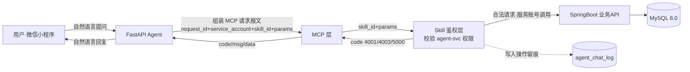

# 09 Agent-Skill-MCP 专项方案

> 东南大学 计算机科学与技术专业 · 软件开发综合课程设计
> 负责人：周子航（方案）｜组长张雨薇（课次 15 集成）｜对应 DESIGN.md §7 Agent-Skill-MCP 方案基线。
> 本阶段只做方案与契约设计，不编码；编码在课次 15 集成开发与测试。

## 1. Skill 能力清单

Skill 筛选标准：**能否被 Agent 调用取决于风险可控性，而非技术可行性**。结合本平台业务逐个评估：删除用户、修改用户密码、批量下架商品、直接落库发布等高风险操作一律不封装为 Skill；仅开放下表 3 项只读或低风险能力。

| Skill 编号 | Skill 名称 | 业务能力描述 | 输入参数 | 返回核心字段 | 允许操作 | 禁止操作 |
|---|---|---|---|---|---|---|
| SK-001 | 商品信息查询 | 按条件查询在售商品的公开信息，支持自然语言转检索条件 | 分类id、关键词、页码 | 商品id、标题、价格、状态 | 按条件查询在售商品 | 修改/删除商品、获取卖家手机号等敏感字段 |
| SK-002 | 商品发布辅助 | 润色商品描述、依据文本推荐分类，辅助卖家快速发布 | 商品草稿文本（标题+描述） | 建议标题、建议描述、推荐分类id | 生成建议文本供用户预览 | 直接落库发布商品（必须经用户在页面上确认后由业务 API 执行） |
| SK-003 | 订单状态查询 | 查询当前用户本人订单的当前状态与流转时间节点 | 订单号（须属于发起对话的用户） | 订单状态、下单/支付/完成时间 | 查询本人订单状态 | 查询他人订单、取消/修改订单、模拟支付 |

## 2. Agent 安全约束

1. **独立服务账号**：设立专门的 Agent 服务账号 `agent-svc`，作为 DESIGN.md §4 中的第四个特殊"用户"，其角色权限仅覆盖上表 Skill 清单内的允许操作；Agent 能做的事不能超过服务账号权限。
2. **独立鉴权，不复用用户 Token**：Agent 调用业务 API 一律使用 `agent-svc` 凭证鉴权，禁止把用户登录 JWT 直接透传给 Skill；用户身份通过报文中的 `user_id`（由 Agent 层从会话上下文注入，不可由模型生成）传递，Skill 层**先鉴权、再转发**业务请求。
3. **越权拦截示例**：即使大模型在对话中决定执行越权指令，Skill-MCP 层直接拦截并返回错误码 `4003`。例如：
   - 用户说"把平台上所有商品都删了"→ SK-001/002/003 均无删除能力，Skill 层匹配不到合法 Skill，返回 `4003 权限不足`，同时写入留痕表。
   - 用户 A 让 Agent 查用户 B 的订单 → SK-003 校验 `order.buyer_id == user_id` 不通过，拒绝转发业务 API，返回 `4003`。
4. **操作留痕**：所有 Agent 调用（无论成功、失败、被拦截）均写入 `agent_chat_log`（服务账号标识、用户id、prompt、skill_name、入参摘要、status、时间），供管理员审计，普通用户不可见。

## 3. MCP 交互初步方案

### 3.1 报文字段

- 请求报文：`request_id`（全局唯一，用于链路追踪）、`service_account`（固定 `agent-svc`）、`skill_id`（如 SK-003）、`params`（该 Skill 的入参集合，含 `user_id`）、`timestamp`（Unix 毫秒，服务端校验 ±5 分钟防重放）。
- 响应报文：`code`（0 成功 / 4001 / 4003 / 5000）、`msg`（标准化错误信息）、`data`（Skill 返回核心字段）。
- 鉴权方式：MCP 请求头携带 `agent-svc` 的服务账号凭证（独立签发的服务令牌，与用户 JWT 体系隔离，可单独吊销）。

### 3.2 错误码定义

| 错误码 | 含义 | 触发场景示例 | Agent 侧处理 |
|---|---|---|---|
| 0 | 成功 | — | 正常组织自然语言回复 |
| 4001 | 参数非法 | SK-001 页码为负、SK-002 草稿文本超长（>2000 字） | 提示用户补充/修正说法，不重试原请求 |
| 4003 | 权限不足 | 请求了未封装为 Skill 的能力、查询他人订单 | 明确回复"该操作不在 Agent 可用范围内" |
| 5000 | 业务错误 | 订单号不存在、数据库异常 | 提示"系统繁忙，请稍后再试"，同一 request_id 不自动重试写操作 |

### 3.3 交互流程图

图 9-1 Agent-Skill-MCP 交互流程（用户→Agent→MCP→Skill→业务API→数据库）：

图例：实线为正常调用链路，虚线为安全留痕旁路；`agent_chat_log` 由 Skill 鉴权层在每次调用结束时统一写入，保证留痕与业务解耦。

## 4. 接口契约（五大设计原则）

作为后端（SpringBoot 业务 API）与 AI 服务（FastAPI Agent）两侧开发的书面依据，逐条落到本项目：

1. **最小权限**：Skill 返回字段白名单化——SK-001 只返回商品 id/标题/价格/状态，卖家手机号等敏感字段一律脱敏或不返回；`agent-svc` 账号仅能调用 Skill 清单内的 3 个只读/低风险接口，无法触达用户管理、商品删除等管理端接口。
2. **输入强校验**：Skill 层使用 Pydantic 模型校验每个 `params` 字段的类型、长度、取值范围——页码 ≥1、草稿文本 ≤2000 字、订单号须匹配"日期+序号"格式且属于当前 `user_id`，校验不通过直接返回 `4001`，不转发业务 API。
3. **独立鉴权**：业务 API 为 `agent-svc` 单独签发服务令牌（独立于用户 JWT 体系），Skill 层先校验服务令牌与 skill_id 的授权关系、再转发请求；用户 JWT 从不进入 MCP 链路，令牌可由管理员在管理端单独吊销。
4. **结果可预期**：错误信息标准化为 `{code, msg, data}` 三段式，Agent 侧不解析业务报错细节，只按 §3.2 错误码表统一话术回复；同一请求以 `request_id` 追踪，写操作（含 SK-002 的落库前确认）不自动重试，保证幂等可预期。
5. **操作留痕**：每次 MCP 调用结束（成功/失败/越权拦截）由 Skill 层写入 `agent_chat_log`（服务账号、skill_name、入参摘要、status、时间），留痕写入失败不影响业务结果但必须告警；管理员可在 PC 管理端按用户与时间段审计 Agent 行为。
