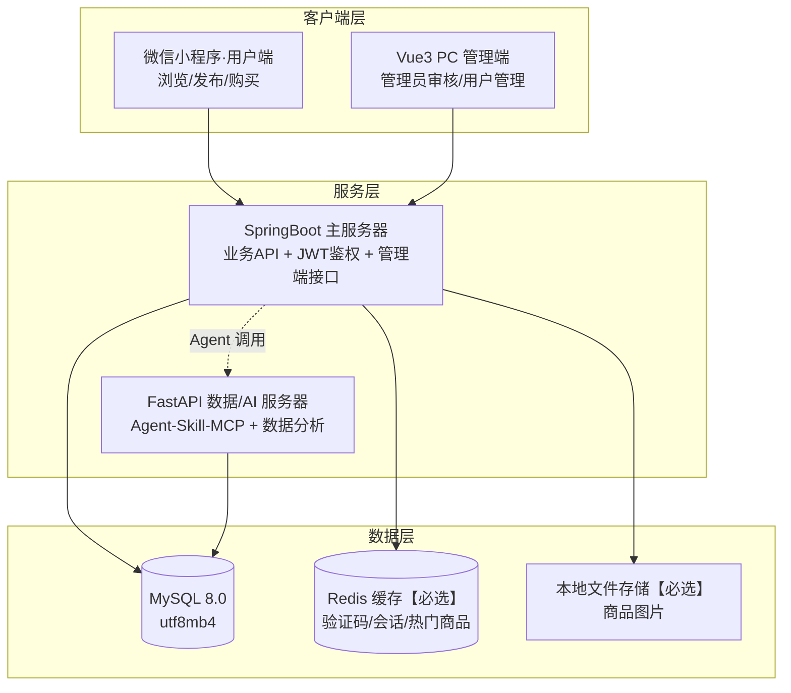
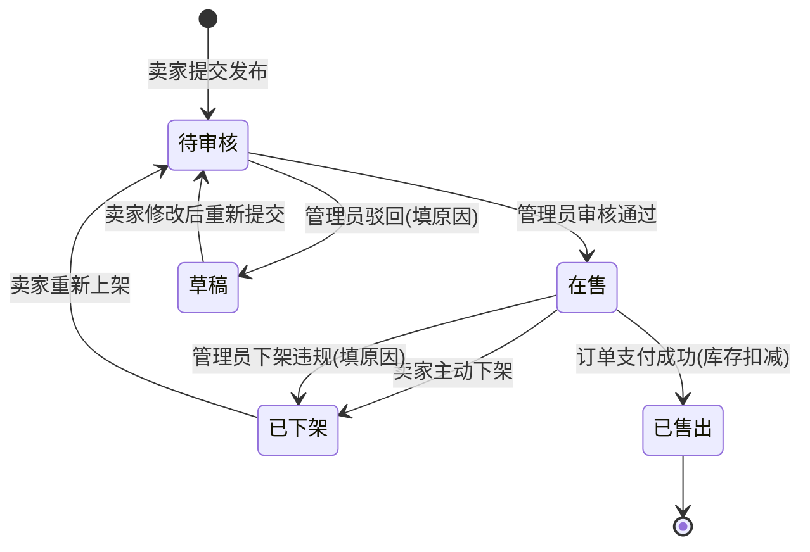
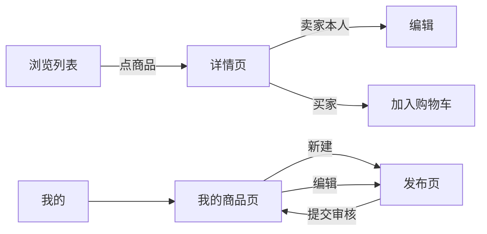
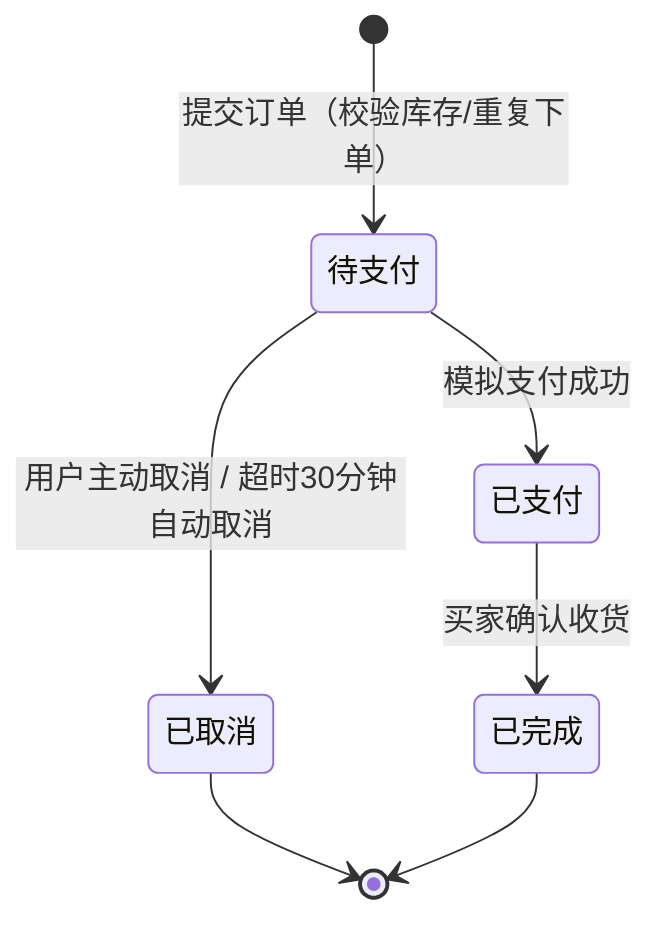
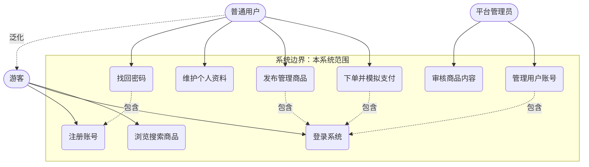
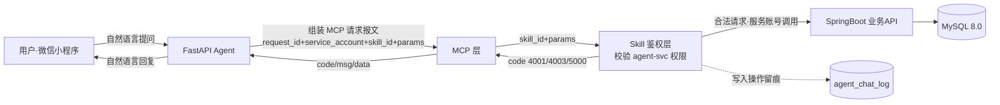

# 软件需求分析报告

> **东南大学 计算机科学与技术专业 · 软件开发综合课程设计（B09P0090）**
> 小组：张雨薇（组长）、万佰鑫（核心开发）、周子航 ｜ 选题：校园二手物品交易平台
> **组长张雨薇汇总，全组共识。** 定稿于 2026-10-14，10-15 前由组长单独提交老师；全员阅读确认后进入下一阶段，定稿后禁止随意新增功能，变更须小组共同评审并记录。

## 报告说明

本报告是小组共同契约，是后续架构设计、数据库设计、编码的输入，按课程要求整合为单一完整文档交付。按课程《需求分析报告》要求组织：选题分工、背景概述、业务线清单、RBAC 权限框架、三大业务模块功能需求、非功能需求、用户画像与用例图、Agent-Skill-MCP 专项。所有条目格式遵循：功能需求 `[角色] 动词+对象，约束条件：...`；非功能需求 `[NFR-编号][类别] 描述`。各章节负责人：第一章张雨薇、第二章张雨薇、第三章万佰鑫、第四章张雨薇、第五章万佰鑫、第六章周子航、第七章周子航、第八章万佰鑫、第九章周子航（方案）/张雨薇（集成）。设计基线见仓库根 `DESIGN.md`（单一事实来源），协作规约见 `CONTRIBUTING.md`；三份个人工作记录（评审会材料）见 `report/工作记录-*.md`。

## 一、小组选题及初步分工记录表

#### 1. 选题信息

| 项目 | 内容 |
|---|---|
| 选题名称 | 校园二手物品交易平台 |
| 选题来源 | 教师题库·普通业务系统通道（非学生自拟，无需额外选题说明） |
| 课程 | 软件开发综合课程设计（B09P0090），2 学分 64 学时 |
| 小组 | 小组（3 人：张雨薇·组长、万佰鑫、周子航） |
| 项目形态 | 中等规模 Web 业务系统：微信小程序用户端 + Vue3 PC 管理端，前后端分离 |

#### 2. 组员与业务模块划分

| 组员 | 角色 | 负责模块 | 模块范围 |
|---|---|---|---|
| 张雨薇 | 组长 | 用户及权限模块 | 注册/登录/找回密码/权限校验/账号管理（封禁解封）/操作日志，RBAC 三层模型落地 |
| 张雨薇 | 组长 | 文档与集成 | 需求文档索引、Git 协作规约、变更历史、阶段测试（tools/validate_report.py） |
| 万佰鑫 | 组员（核心开发） | 商品发布模块 | 商品 CRUD、分类、多图上传、库存、上下架、审核流 |
| 万佰鑫 | 组员（核心开发） | 项目文档与工程化 | 项目 README 主笔、工程脚手架规划（四端）、阶段校验脚本（tools/validate_phase2.py） |
| 周子航 | 组员 | 购物交易模块 | 购物车、订单、模拟支付、状态流转、交易记录 |
| 周子航 | 组员 | Agent-Skill-MCP 子系统（方案） | Skill 能力清单、Agent 安全约束、MCP 交互方案；课次 15 由张雨薇（集成）+周子航（方案）共同落地 |

#### 3. 范围边界说明（系统做什么 / 不做什么）

依据 DESIGN.md §1 的范围三级裁剪：

| 级别 | 内容 |
|---|---|
| **必做（本系统做）** | 注册登录（手机号+验证码）、商品发布/浏览、购物车、订单交易（模拟支付）、管理员审核 |
| **可选（时间允许再做）** | 评价体系、消息通知 |
| **第一版不做（明确出界）** | 即时聊天（站内沟通延后）、复杂风控、第三方真实支付（用模拟支付代替）、ES 搜索（用 MySQL LIKE/索引代替） |

出界说明的意义：防止需求阶段范围蔓延，任何新增功能必须小组共同评审、记录变更原因并更新文档（需求文档为全员共识契约）。

#### 4. 三条铁律自查

课程要求选题必须满足三条铁律，逐条自查如下：

| 铁律 | 要求 | 本项目自查 |
|---|---|---|
| 规模达标 | 中等规模：用户权限模块 + ≥2 个核心业务模块 + 交互流程模块，核心 user story 7-8 条 | ✅ 用户及权限（张雨薇）+ 商品发布（万佰鑫）+ 购物交易（周子航）三个模块，加交互流程；DESIGN.md §9 固定 **8 条核心 user story**（US-01~US-08），落在区间内 |
| 技术可控 | 技术栈小组可控，预留接口，支持全套文档 | ✅ 微信小程序原生 + Vue3 + SpringBoot 3（Java 17）+ FastAPI（Python 3.11）+ MySQL 8.0 + Redis + 本地文件存储，均为小组成员熟悉、课程推荐栈；接口统一 `/api/v1/` 前缀预留扩展 |
| 含权限模块 | 必须含登录注册、角色权限（RBAC） | ✅ 用户→角色→权限三层 RBAC（游客/普通用户/平台管理员 + agent-svc 服务账号），详见 报告第四章 |

#### 5. 备注

- 本表为第 1 课课堂任务 1 的课后整理稿，纳入《软件需求分析报告》章节一。
- 与 DESIGN.md 冲突时以 DESIGN.md 为准（单一事实来源）。

## 二、项目背景与系统概述

#### 1. 项目背景与痛点

高校校园内学生二手物品流转需求长期旺盛：毕业季书籍、电器、自行车集中处理，新生入学又恰好需要这些低价实用物品。目前的现状与痛点：

- **渠道散**：二手交易散落在校园墙 QQ 群、微信群、表白墙帖子中，信息碎片化，卖家发布后难以被精准检索，买家找一件"大二高数教材"要翻几百条群聊记录。
- **信任弱**：群聊交易无平台背书，买卖双方互不了解；出现货不对板、爽约后没有投诉与管理渠道，管理员无法下架违规信息。
- **管理缺**：校园群管理员靠人工删帖，无账号封禁机制，违规发布者换个号即可继续；管理员的关键操作也没有留痕，无法追责。
- **沟通低效**：群聊里问价、砍价、约面交的消息互相淹没，买家无法跟踪自己感兴趣的多个商品。

本系统将上述散乱流程收拢为一个平台：**小程序端面向普通学生完成浏览、发布、购物车、下单与模拟支付；PC 管理端面向平台管理员完成商品审核与用户账号管理**，并以 RBAC 权限体系与操作日志保障平台可管理、可追责。

#### 2. 系统拓扑

系统采用前后端分离架构，双端（小程序用户端 + PC 管理端）共用同一套主服务 API；同时为课次 15 的 Agent 集成预留 FastAPI 数据/AI 服务器链路。



图 2-1 系统拓扑图（与 DESIGN.md §2 一致）

- 前后端分离：小程序面向普通用户，PC 管理端面向平台管理员；
- Agent 链路：用户自然语言 → FastAPI Agent → MCP 报文 → Skill 鉴权 → 转发业务 API（详见 报告第九章 专项小节）。

#### 3. 技术栈说明

| 层 | 选型 | 说明 |
|---|---|---|
| 用户端 | 微信小程序原生（WXML/WXSS/JS） | 面向学生，校园场景天然适合小程序，无需安装 |
| 管理端 | Vue3 + Vite + Element Plus | 面向平台管理员的 PC 端 |
| 主服务 | Java 17 + SpringBoot 3 + MyBatis-Plus + JWT | 业务 API + JWT 鉴权 + 管理端接口，统一前缀 `/api/v1/`，返回 `{code, msg, data}` |
| 数据/AI 服务 | Python 3.11 + FastAPI + Pydantic + SQLAlchemy | Agent-Skill-MCP 子系统与数据分析 |
| 数据库 | MySQL 8.0（InnoDB，utf8mb4_unicode_ci） | 核心业务数据 |
| 缓存 | Redis【必选】 | 验证码、会话、热门商品列表 |
| 文件系统 | 本地磁盘存储商品图片，Nginx/静态映射【必选】 | 商品图片上传与访问 |
| 搜索 | MySQL LIKE/索引 | 第一版不引入 ES（DESIGN.md §1 裁剪项） |

#### 4. 系统边界（第一版不做清单）

明确**不在本系统第一版范围内**的事项（DESIGN.md §1 三级裁剪），防止需求蔓延：

| 不做项 | 代替方案 |
|---|---|
| 即时聊天 | 面交自约，站内消息系统列为可选模块 |
| 复杂风控 | 基础账号封禁/解封 + 操作日志兜底 |
| 第三方真实支付 | 模拟支付（订单状态流转到"已支付"） |
| ES 搜索 | MySQL LIKE/索引关键词检索 |
| 评价体系、消息通知 | 列为可选模块，时间允许再做 |

任何新增功能须小组共同评审、记录变更原因并更新本文档。

## 三、业务线清单

#### 四步法说明

| 步骤 | 本项目回答 |
|---|---|
| ① 从用户目标出发 | 校园学生想把闲置物品变现、想低价买到同学的二手物品；平台管理员要维持交易秩序 |
| ② 按目标归集功能 | 把"变现"归为商品发布线，"低价买到"归为购物交易线，两类操作都依赖账号身份，归为用户账号线 |
| ③ 列出关键操作 | 每条业务线下纵向列出流程节点与用户在该节点的关键操作（见下文各业务线） |
| ④ 判断系统边界 | 明确哪些不做（见"系统边界"一节），避免需求膨胀 |

#### 业务线一：用户账号（支撑线）

**用户目标**：用校园身份在平台上留下可信记录，发布和购买都有据可查。

流程节点与关键操作：

1. **注册**：用户用手机号 + 验证码注册账号（手机号唯一，验证码 5 分钟内有效）。
2. **登录**：用户用手机号 + 密码（或验证码）登录，登录成功获得 JWT 令牌。
3. **找回密码**：忘记密码时，用户用绑定手机号接收验证码重置密码。
4. **个人信息维护**：用户修改昵称、头像，查看自己账号的封禁/解封状态。

关键操作汇总：注册、登录、找回密码、改昵称/头像、查看账号状态。

#### 业务线二：商品发布（万佰鑫负责）

**用户目标**：卖家把闲置物品（教材、电器、自行车等）挂到平台上，标价出售。

流程节点与关键操作：

1. **登录**：未登录用户不能发布；登录后进入"我的商品"。
2. **发布商品**：卖家填写标题、描述、价格、分类（教材/数码/生活用品等二级分类），上传 1-6 张实拍图，设置库存（≥1），提交后进入待审核状态。
3. **编辑商品**：卖家可修改价格、描述、图片等，已售出/已下架的商品不可编辑。
4. **下架商品**：卖家可主动下架在售商品（如已卖出）；管理员也可下架违规商品并填写原因，卖家在下架列表能看到原因。

关键操作汇总：填商品信息、传图片、选分类、设库存、提交审核、编辑、主动下架、查看违规下架原因。

#### 业务线三：购物交易（周子航负责）

**用户目标**：买家按分类和关键词找到心仪二手物品，下单并用模拟支付完成交易。

流程节点与关键操作：

1. **浏览**：游客即可按分类、关键词（MySQL LIKE/索引搜索）浏览在售商品列表。
2. **加入购物车**：买家把在售商品加入购物车，可调整数量（不超过库存）。
3. **创建订单**：买家从购物车或商品页提交订单，锁定成交价。
4. **模拟支付**：买家在待支付订单上点击"模拟支付"完成支付，订单流转到已支付/已完成；超时或主动取消则关闭。

关键操作汇总：搜索/筛选、加购、改数量、下单、模拟支付、取消订单、查看交易记录。

#### 系统边界（第一版不做）

依据 `DESIGN.md §1 范围三级裁剪`，以下内容**明确不在本系统范围内**，写需求文档时不为其编造需求条目：

| 不做的内容 | 理由 | 替代方案 |
|---|---|---|
| 即时聊天 | 买卖双方私信沟通涉及消息实时推送，工作量超出第一版规模底线 | 商品描述写清成色与瑕疵，买家按页面信息自主下单 |
| 第三方真实支付 | 对接微信支付/支付宝需商户资质，课程环境不可行 | 模拟支付：订单状态直接流转，仅作交易流程演示 |
| 复杂风控 | 设备指纹、异常行为识别等超出中等规模系统范围 | 管理员人工审核 + 封禁账号兜底 |
| ES 搜索 | 搜索引擎部署维护成本高 | MySQL LIKE/索引实现分类与关键词搜索 |

> 评价体系、消息通知为可选范围（DESIGN.md §1），第一版暂不列入功能需求，仅在数据表中预留 `review`、`message` 表。

## 四、用户及权限模块需求（重点章节）

#### 1. 角色权限框架与 RBAC 对照表

采用 **用户 → 角色 → 权限** 三层模型（DESIGN.md §4）：用户不直接持有权限，通过被赋予的角色获得权限集合；管理员与普通用户的差异、游客的限制、Agent 服务账号的边界都收敛在角色层控制，后续新增角色只需加角色-权限映射，不改业务代码。

#### 1.1 角色定义

| 角色 | 身份说明 | 核心权限 |
|---|---|---|
| 游客 | 未登录访问者 | 浏览商品、按分类/关键词搜索 |
| 普通用户 | 买家/卖家合一（学生主体） | 注册登录、发布/编辑/下架自己的商品、购物车、下单、模拟支付、个人信息维护 |
| 平台管理员 | 平台运营管理 | 下架违规商品（填写原因）、管理用户账号（封禁/解封）、查看全部订单、查看操作日志 |
| agent-svc | Agent 服务账号（特殊"用户"） | 仅拥有 报告第九章 Skill 清单内的允许操作（商品查询/发布辅助/订单查询），不拥有用户登录态 |

#### 1.2 用户-角色-权限对照表

| 用户类型 | 角色 | 具体权限点 | 权限校验方式 |
|---|---|---|---|
| 未登录访客 | 游客 | `goods:browse`、`goods:search` | 接口白名单放行 |
| 注册学生 | 普通用户 | 游客全部权限 + `user:register`、`user:login`、`user:profile:update`、`user:password:reset`、`goods:publish`(限本人)、`goods:edit`(限本人)、`goods:offshelf`(限本人)、`cart:manage`、`order:create`、`order:pay`(模拟)、`order:view`(限本人) | JWT 登录态 + 资源属主校验（`user_id` 比对） |
| 运营人员 | 平台管理员 | 普通用户全部权限 + `admin:goods:offshelf`(任意商品)、`admin:user:ban`、`admin:user:unban`、`admin:order:view-all`、`admin:oplog:view` | JWT + 角色注解（`@RequireRole("ADMIN")`） |
| 服务账号 | agent-svc | `skill:goods:query`、`skill:publish:assist`、`skill:order:query`(限发起用户本人) | Skill 层独立鉴权，不复用用户 Token；越权指令直接拒绝并写 `agent_chat_log` |

> 说明：账号封禁后该用户所有需登录的权限点全部失效，仅保留游客级浏览权限；解封后恢复普通用户权限。

#### 2. 功能性需求清单（本模块）

格式：`[角色] 动词+对象，约束条件：...`。

- [游客] 可以浏览在售商品列表并按分类、关键词搜索，约束条件：游客只能看到状态为"在售"的商品，不能进入购物车、下单等需登录页面，未登录访问受限接口统一返回 401 并引导登录。
- [普通用户] 可以通过手机号+短信验证码完成注册，约束条件：手机号全平台唯一不可重复注册；验证码 6 位数字、5 分钟内有效（存 Redis）、同一手机号 60 秒内只能获取一次；昵称默认"用户+手机号后四位"，可后续修改。
- [普通用户] 可以使用手机号+密码或手机号+验证码登录，约束条件：密码连续输错 5 次锁定账号 30 分钟；登录成功签发 JWT（有效期 2 小时，Redis 记录会话支持主动失效）；被封禁账号登录时明确提示"账号已被封禁，请联系管理员"。
- [普通用户] 可以通过"手机号验证码校验→设置新密码"流程找回密码，约束条件：仅向注册时绑定的手机号发送验证码；新密码须 8-20 位且包含字母和数字；找回流程产生的旧会话全部失效。
- [普通用户] 可以维护个人资料（昵称、头像、个性签名），约束条件：手机号为账号标识不允许修改；昵称长度 2-20 字符且不做全平台唯一限制；头像上传仅支持 jpg/png 且不超过 2MB。
- [普通用户] 可以发布、编辑、下架自己的商品并进入购物交易流程，约束条件：发布商品须处于正常（未封禁）账号状态；所有需登录接口由权限校验中间件校验 JWT，资源属主校验失败返回 403。
- [平台管理员] 可以封禁或解封任意普通用户账号，约束条件：封禁时必须填写封禁原因（1-100 字），封禁后该用户立即下线（JWT 失效）且无法登录、其"在售"商品自动下架；解封后账号恢复原角色权限，被封禁商品需卖家手动重新上架。
- [平台管理员] 可以查看管理员关键操作日志，约束条件：封禁/解封、下架商品、强制下线等关键操作写入 `admin_op_log`（操作人、动作、目标类型、目标 id、详情、时间），日志只读不可修改删除，按时间倒序分页展示。
- [平台管理员] 可以按手机号、昵称、状态（正常/封禁）搜索并查看用户列表，约束条件：列表展示注册时间、角色、最近登录时间；单个用户详情页可查看其发布的全部商品与订单记录。
- [agent-svc] 可以通过 Skill 层以服务账号身份执行清单内操作（商品查询、发布辅助、订单查询），约束条件：agent-svc 不复用用户登录 Token，Skill 层先鉴权再转发，超出清单允许操作的指令一律返回 4003 并写 `agent_chat_log` 留痕。

#### 3. 模块内用例覆盖说明

本模块需求覆盖 DESIGN.md §9 中 US-01（注册）、US-02（登录/找回密码）、US-08（管理员封禁/解封与日志），并与万佰鑫负责的商品模块（US-03/04/06/07 中的登录前提）和周子航负责的交易模块（US-05 中的登录前提）通过 JWT 权限校验中间件衔接。用户画像与用例图见 报告第八章。

#### 4. 本模块原型页面说明

原型仅表达页面流转与输入项，不做视觉美化（原型 zip 于 10-22 前随需求文档一并提交，此处为页面规格）。

#### 4.1 注册页

- **输入项**：手机号（11 位）、短信验证码（6 位）、密码（8-20 位含字母数字）、确认密码；"获取验证码"按钮（点击后 60 秒倒计时）；"同意《平台使用协议》"勾选框。
- **校验与流转**：手机号格式/唯一性即时校验 → 验证码校验（Redis 5 分钟有效）→ 注册成功自动登录并跳转首页；失败在页内提示（手机号已注册/验证码错误或过期/两次密码不一致）。

#### 4.2 登录页

- **输入项**：手机号、密码（"验证码登录"Tab 切换为验证码输入框+获取验证码按钮）；"忘记密码"链接、"注册新账号"链接。
- **校验与流转**：登录成功 → 按角色跳转（普通用户→小程序首页；管理员→跳转 PC 管理端登录入口）；账号被锁提示剩余时间；封禁账号提示封禁原因摘要与申诉入口。

#### 4.3 个人中心页

- **输入项（资料区）**：头像（点击上传）、昵称、个性签名；手机号只读展示。
- **输入项（安全区）**：修改密码（原密码+新密码+确认新密码）、绑定/换绑手机号入口（第一版只读，换绑列为可选）。
- **流转关系**：个人中心 → 我的发布（跳商品模块）/ 我的订单（跳交易模块）/ 退出登录（清除本地 Token 与 Redis 会话）。

#### 4.4 页面流转图

```mermaid
graph LR
    A[启动/首页] -->|未登录点"我的"| L[登录页]
    L -->|没有账号| R[注册页]
    L -->|忘记密码| F[找回密码页]
    R -->|注册成功自动登录| H[首页·已登录态]
    F -->|设置新密码成功| L
    L -->|登录成功| H
    H -->|点"我的"| P[个人中心]
    P --> E[编辑资料]
    P --> S[修改密码]
    P -->|退出登录| A
```

图 4-1 用户及权限模块页面流转图（注册页/登录页/个人中心/找回密码页）

## 五、商品发布模块需求

### 一、功能需求清单

格式约定：`[角色] 动词+对象，约束条件：...`。

- [卖家] 可以填写标题、描述、价格、分类并上传 1-6 张实拍图发布商品，约束条件：标题 5-40 字、描述 10-500 字、价格 0.01-9999 元且保留两位小数、必须选择一个二级分类，提交后商品进入"待审核"状态，审核通过才对买家可见。
- [卖家] 可以为商品设置库存数量，约束条件：库存为 1-99 的整数，单个商品每次最多可发布 99 件（限量转卖），库存为 0 时商品自动变为不可购买状态。
- [卖家] 可以为同一商品上传多张图片，约束条件：单张图片不超过 5MB、支持 jpg/png/webp 格式、每个商品最多 6 张，第一张默认为主图，图片按上传顺序排序。
- [卖家] 可以编辑自己在售的商品信息，约束条件：仅能编辑自己发布的商品；已售出或已被管理员下架的商品不可编辑；修改价格后 10 分钟内该商品暂停被下单，防止价格争议。
- [卖家] 可以主动下架自己发布的商品，约束条件：仅"在售"状态的商品可主动下架；下架后商品立即从买家浏览列表消失，但历史订单不受影响。
- [普通用户] 可以按分类与关键词浏览搜索商品，约束条件：游客即可浏览"在售"状态的商品；搜索范围含标题与描述，使用 MySQL LIKE/索引实现（第一版不做 ES）；待审核、已下架的商品不出现在结果中。
- [平台管理员] 可以下架任意用户发布的违规商品，约束条件：下架时必须填写下架原因（10-200 字），原因对卖家可见；本次操作写入管理员操作日志（`admin_op_log`）。
- [平台管理员] 可以审核待审核商品并决定通过或驳回，约束条件：驳回时填写驳回原因（如标题含违规词、图片与描述不符）；驳回后商品回到"草稿"状态，卖家可修改后重新提交。
- [卖家] 可以查看自己全部商品的状态列表（我的商品页），约束条件：列表按创建时间倒序，展示状态标签（在售/待审核/已下架/已售出）与被下架原因；支持按状态筛选。

### 二、商品分类约定（第一版）

一级分类固定四类，二级分类可由管理员维护（`category` 表，`parent_id` 支持层级）：

| 一级分类 | 二级分类示例 |
|---|---|
| 教材书籍 | 专业课教材、考研考公、课外读物 |
| 数码电子 | 手机、电脑、耳机、平板 |
| 生活用品 | 台灯、收纳、小家电 |
| 运动出行 | 自行车、球拍、健身器材 |

约束：发布商品必须挂到二级分类节点；一级分类仅用于导航。

### 三、商品状态流转



### 四、本模块原型页面说明

原型重点在**页面流转与输入项**，不追求 UI 美化（线框即可，10-22 前随原型 zip 提交）。

#### 4.1 发布页（普通用户）

- **进入方式**：底部导航"发布"按钮，未登录则跳转登录页。
- **输入项**：
  - 标题（必填，字数计数器 5-40）
  - 分类（一级 → 二级级联选择器，必填）
  - 价格（数字键盘，必填）+ 是否可议价开关
  - 库存（默认 1，步进器 1-99）
  - 商品描述（多行文本，必填）
  - 图片上传（九宫格上传控件，最多 6 张，第一张标记"主图"）
- **操作流转**：填写完成 → 点"提交审核" → 弹窗二次确认 → 成功提示"已提交，等待管理员审核" → 跳转"我的商品"页。
- **异常分支**：必填缺失/格式错误 → 对应输入框红字提示，不跳转；图片上传中禁止提交。

#### 4.2 商品详情页（游客/买家）

- **进入方式**：浏览列表点入任意"在售"商品。
- **展示项**：主图轮播 + 缩略图列表、标题、价格、分类路径、库存、卖家昵称、发布时间、商品描述全文。
- **操作流转**：
  - 游客点"加入购物车" → 提示"请先登录" → 跳转登录页；
  - 买家点"加入购物车" → 成功后角标 +1，可继续浏览；
  - 卖家本人查看自己商品时，按钮区替换为"编辑 / 下架"，不显示购买按钮。
- **输入项**：无（只读页 + 数量选择弹层）。

#### 4.3 我的商品页（卖家）

- **进入方式**："我的"页 → "我的商品"入口。
- **展示项**：按状态筛选的 Tab（全部/在售/待审核/已下架/已售出），每条商品卡片显示主图缩略、标题、价格、库存、状态标签；被管理员下架的商品卡片上展示下架原因。
- **操作流转**：
  - 点"编辑" → 复用发布页表单，预填原数据 → 保存 → 状态不变的直接生效；
  - 点"下架" → 弹窗确认"下架后买家将无法看到该商品" → 状态变为已下架；
  - 草稿/已下架商品点"重新上架" → 进入待审核。

#### 4.4 页面流转总览



## 六、购物交易模块需求（购物车 / 订单 / 模拟支付）

#### 1. 功能需求清单

- [普通用户] 可以将状态为"在售"的商品加入购物车，约束条件：每次点击购买数量默认加 1，同一商品重复加入仅累加数量不生成重复记录，购物车内商品种类上限 20 种。
- [普通用户] 可以调整购物车内商品的购买数量或移除商品，约束条件：购买数量必须在 1 至该商品剩余库存之间，移除操作即时生效且不需二次确认。
- [普通用户] 可以在购物车勾选商品提交订单，约束条件：提交时后端二次校验商品状态仍为"在售"且库存充足，成交价 deal_price 按下单时刻的商品价格快照生成，订单号 order_no 按"日期+当日序号"规则生成且全局唯一。
- [普通用户] 对同一商品重复提交订单时触发重复下单校验，约束条件：同一买家对同一商品存在"待支付"订单时再次下单，系统拦截并提示已存在待支付订单，引导用户选择"前往支付"或"取消原订单后重新下单"。
- [普通用户] 可以对"待支付"订单完成模拟支付，约束条件：支付页展示订单号与应付金额，确认后订单状态由"待支付"变更为"已支付"并记录支付时间，扣减对应商品库存；模拟支付仅在本系统内完成状态变更，不接入真实第三方支付渠道。
- [普通用户] 可以取消未支付的订单，约束条件：仅"待支付"状态允许主动取消，取消后不扣减库存并释放商品回"在售"状态；订单超过 30 分钟未支付由系统定时任务自动取消。
- [普通用户] 可以对"已支付"订单确认收货，约束条件：确认收货后订单状态置为"已完成"，已完成的订单不可再变更状态，作为后续可选评价模块的前置数据。
- [普通用户] 可以查看本人全部订单列表与订单详情，约束条件：订单状态机固定为"待支付→已支付→已完成"或"待支付→已取消"两条路径，任何非法状态跳转（如对已取消订单再支付）一律由后端拒绝并返回业务错误。

#### 2. 订单状态流转说明



- 状态变更只允许由后端服务触发，前端不直接修改状态。
- 每次状态变更记录时间节点（下单时间、支付时间、完成/取消时间），供订单详情页展示与对账。

#### 3. 本模块原型页面说明

原型阶段共 3 个页面，页面流转：**商品详情页 →（加入购物车）→ 购物车页 →（去结算）→ 确认订单页 →（模拟支付）→ 订单列表页**。

#### 3.1 购物车页（cart）

- **入口**：底部 Tab"购物车"、商品详情页"加入购物车"成功后的引导跳转。
- **展示项**：商品图片缩略图、标题、单价、购买数量（可 +/−）、小计金额、复选框。
- **输入项**：数量调整（步进器）、移除商品、全选/单选勾选。
- **操作与流转**：底部常驻"已选合计 + 去结算"按钮；点击"去结算"校验至少勾选 1 件且库存充足，通过后携带选中商品 id 列表跳转确认订单页；点击商品区域可回跳商品详情页。

#### 3.2 确认订单页（order-confirm）

- **入口**：购物车页"去结算"。
- **展示项**：收货信息（第一版简化为文本备注，不做地址库）、商品清单、单价快照、数量、合计金额。
- **输入项**：收货备注（选填，≤100 字）、支付方式仅"模拟支付"一项（只读展示）。
- **操作与流转**：点击"提交订单"→ 后端执行库存与重复下单校验 → 校验通过跳转模拟支付确认弹窗（展示订单号、金额）→ 支付成功跳转订单列表页并置顶展示该订单；校验失败在页内 toast 提示原因（如"存在待支付订单"）。

#### 3.3 订单列表页（order-list）

- **入口**：个人中心"我的订单"、支付成功跳转。
- **展示项**：按状态分 Tab（全部/待支付/已支付/已完成/已取消），每条订单展示订单号、商品标题、成交价快照、状态、关键时间节点。
- **输入项**：状态 Tab 切换、下拉刷新。
- **操作与流转**："待支付"订单提供"去支付"（复用模拟支付弹窗）与"取消订单"（二次确认）按钮；"已支付"订单提供"确认收货"按钮；点击订单条目进入订单详情查看状态流转时间线。

## 七、非功能性需求

- [NFR-01][性能] 用户端核心页面（商品列表、购物车、订单列表）在 50 并发用户下单/浏览场景下接口响应时间 <2s，约束验收：热门商品列表命中 Redis 缓存返回，商品标题查询走 MySQL 索引，压测报告记录 95 分位响应时间。
- [NFR-02][安全] 用户密码必须加密存储，约束验收：`user.password_hash` 采用 BCrypt 加盐哈希，数据库导出与后端日志中不得出现任何明文密码，注册/登录接口报文不回传密码字段。
- [NFR-03][安全] 全站数据传输必须走 HTTPS，约束验收：小程序端与 PC 管理端对后端 API 的请求均配置为 https，后端对 http 请求重定向或直接拒绝，证书部署于 Nginx 层。
- [NFR-04][安全] 管理员关键操作必须留痕，约束验收：管理员下架违规商品、封禁/解封用户账号时强制填写原因并写入 `admin_op_log`（操作人、动作、目标类型、目标 id、原因、时间），操作日志可在管理端查询且普通用户不可见。
- [NFR-05][易用性] 核心购买流程"加入购物车→提交订单→模拟支付"不超过 3 次页面跳转，约束验收：表单校验错误在对应字段旁即时提示（非弹窗打断），支付成功 2 秒内自动跳转订单列表页。
- [NFR-06][兼容性] 小程序端兼容微信基础库 2.20.0 及以上版本，约束验收：在 iOS 与 Android 各一台真机（微信最新稳定版）上完成商品浏览、下单、支付全流程回归；PC 管理端兼容 Chrome、Edge、Safari 最近两个大版本。
- [NFR-07][可维护性] 后端接口统一遵循 DESIGN.md §8 规范（前缀 `/api/v1/`、返回 `{code, msg, data}`、JWT 鉴权），约束验收：代码评审时新增接口必须同步更新接口文档，错误码全局唯一并集中定义（含 MCP 错误码 4001/4003/5000），禁止各模块自定义零散错误码。
- [NFR-08][可维护性] 订单状态机收敛在单一服务类中实现，约束验收：任何状态变更必须经由统一的状态流转方法并校验合法迁移路径，禁止在业务代码中散落 `UPDATE orders SET status=...` 的直改语句，代码评审按此检查。

## 八、用户画像与系统用例图

### 一、用户画像角色卡片（四要素：背景 / 使用目标 / 痛点 / 典型场景）

#### 卡片 1：买家 · 学生小林

| 要素 | 内容 |
|---|---|
| **背景** | 大二计算机专业学生，住宿舍 6 楼，月生活费 2000 元，预算敏感但想要性价比，手机为主要上网设备 |
| **使用目标** | 在毕业季/开学季低价买到学长学姐的二手教材、台灯、自行车，花最少时间淘到合适物品 |
| **痛点** | 校园群里二手信息刷屏难检索、真假与成色难判断、约线下交易经常放鸽子、没有交易记录可依 |
| **典型场景** | 开学第一周，小林打开小程序按"教材书籍→专业课教材"筛选，用关键词"数据结构"搜索，找到一本 15 元的教材，加入购物车后下单模拟支付，晚上到卖家宿舍楼下凭订单取书 |

#### 卡片 2：卖家 · 学生小雨

| 要素 | 内容 |
|---|---|
| **背景** | 大四毕业生，行李托运限额有限，宿舍积攒了吉他、小冰箱、几十本教材急需出手，会用手机拍照但不会写文案 |
| **使用目标** | 毕业离校前把闲置物品快速卖掉变现，商品描述清楚、免去看房砍价的反复沟通 |
| **痛点** | 自己写不出吸引人的商品描述；挂出去几天没人问；被压价到心态崩溃；有的东西卖了却遇到买家反悔 |
| **典型场景** | 小雨用发布页给吉他拍照上传 4 张图，借用商品发布辅助（Agent 建议文案，SK-002）润色描述后提交，商品审核通过后在售；三天后收到订单支付通知，按订单信息与买家当面交付，订单标记已完成 |

#### 卡片 3：平台管理员 · 王老师助教小周

| 要素 | 内容 |
|---|---|
| **背景** | 平台运营方的学生助教，PC 端办公为主，每天用零碎时间巡检平台内容，对校园违禁品（代写、危险物品）和纠纷负责 |
| **使用目标** | 保证平台上架内容合规、账号行为可信，及时下架违规商品并留下可追溯的处理记录 |
| **痛点** | 新商品量大逐条看不过来；下架后卖家来"申诉"时拿不出处理依据；处理记录散落没有日志可查 |
| **典型场景** | 小周在 PC 管理端看到一件标题夸大"全新 iPhone 999 元"的商品，点开详情确认图片与描述不符，填写下架原因后执行下架；系统自动记录其管理员操作日志，随后封禁该卖家 7 天，日志中同样留痕 |

### 二、系统用例图

覆盖用户与权限相关业务（注册/登录/找回密码/个人资料/账号管理），用例粒度 = 完整业务目标。



**图 1：系统用例图（用户与权限重点覆盖）**

#### 图例说明

- `([参与者])`：系统外的人员角色，本图共 3 个——游客、普通用户、平台管理员（买卖合一，对应 DESIGN.md §4）。
- `(用例)`：框内的椭圆为系统用例，粒度为完整业务目标（如"发布管理商品"涵盖发布/编辑/下架一整条业务线，不拆到"点按钮"级）。
- `实线 -->`：参与者与用例的**关联**关系。
- `-. 包含 .->`：**包含**关系——虚线箭头指向被必须执行的用例（如发布商品必须先登录）。
- `-. 泛化 .->`：**泛化**关系——普通用户继承游客的全部用例（登录、浏览）。
- **系统边界**：外框"校园二手物品交易平台"即边界，框内为本系统第一版范围，框外参与者不进入系统；**数据库、SpringBoot/FastAPI 服务器是系统内部组件，不作为参与者出现在图中**。

#### 系统边界说明

- **框内（第一版做）**：注册登录（手机号+验证码）、找回密码、个人资料维护、商品发布/浏览、购物车与模拟支付订单、管理员审核与账号管理。
- **框外（第一版不做，引用 DESIGN.md §1）**：即时聊天、第三方真实支付、复杂风控、ES 搜索；评价体系与消息通知为可选，暂不绘制为用例。
- 游客可浏览与注册登录，但发布、下单必须登录（用例包含关系体现该权限约束）；管理用户账号与审核仅平台管理员可用，对应 PC 管理端。

## 九、Agent-Skill-MCP 专项方案

#### 1. Skill 能力清单

Skill 筛选标准：**能否被 Agent 调用取决于风险可控性，而非技术可行性**。结合本平台业务逐个评估：删除用户、修改用户密码、批量下架商品、直接落库发布等高风险操作一律不封装为 Skill；仅开放下表 3 项只读或低风险能力。

| Skill 编号 | Skill 名称 | 业务能力描述 | 输入参数 | 返回核心字段 | 允许操作 | 禁止操作 |
|---|---|---|---|---|---|---|
| SK-001 | 商品信息查询 | 按条件查询在售商品的公开信息，支持自然语言转检索条件 | 分类id、关键词、页码 | 商品id、标题、价格、状态 | 按条件查询在售商品 | 修改/删除商品、获取卖家手机号等敏感字段 |
| SK-002 | 商品发布辅助 | 润色商品描述、依据文本推荐分类，辅助卖家快速发布 | 商品草稿文本（标题+描述） | 建议标题、建议描述、推荐分类id | 生成建议文本供用户预览 | 直接落库发布商品（必须经用户在页面上确认后由业务 API 执行） |
| SK-003 | 订单状态查询 | 查询当前用户本人订单的当前状态与流转时间节点 | 订单号（须属于发起对话的用户） | 订单状态、下单/支付/完成时间 | 查询本人订单状态 | 查询他人订单、取消/修改订单、模拟支付 |

#### 2. Agent 安全约束

1. **独立服务账号**：设立专门的 Agent 服务账号 `agent-svc`，作为 DESIGN.md §4 中的第四个特殊"用户"，其角色权限仅覆盖上表 Skill 清单内的允许操作；Agent 能做的事不能超过服务账号权限。
2. **独立鉴权，不复用用户 Token**：Agent 调用业务 API 一律使用 `agent-svc` 凭证鉴权，禁止把用户登录 JWT 直接透传给 Skill；用户身份通过报文中的 `user_id`（由 Agent 层从会话上下文注入，不可由模型生成）传递，Skill 层**先鉴权、再转发**业务请求。
3. **越权拦截示例**：即使大模型在对话中决定执行越权指令，Skill-MCP 层直接拦截并返回错误码 `4003`。例如：
   - 用户说"把平台上所有商品都删了"→ SK-001/002/003 均无删除能力，Skill 层匹配不到合法 Skill，返回 `4003 权限不足`，同时写入留痕表。
   - 用户 A 让 Agent 查用户 B 的订单 → SK-003 校验 `order.buyer_id == user_id` 不通过，拒绝转发业务 API，返回 `4003`。
4. **操作留痕**：所有 Agent 调用（无论成功、失败、被拦截）均写入 `agent_chat_log`（服务账号标识、用户id、prompt、skill_name、入参摘要、status、时间），供管理员审计，普通用户不可见。

#### 3. MCP 交互初步方案

#### 3.1 报文字段

- 请求报文：`request_id`（全局唯一，用于链路追踪）、`service_account`（固定 `agent-svc`）、`skill_id`（如 SK-003）、`params`（该 Skill 的入参集合，含 `user_id`）、`timestamp`（Unix 毫秒，服务端校验 ±5 分钟防重放）。
- 响应报文：`code`（0 成功 / 4001 / 4003 / 5000）、`msg`（标准化错误信息）、`data`（Skill 返回核心字段）。
- 鉴权方式：MCP 请求头携带 `agent-svc` 的服务账号凭证（独立签发的服务令牌，与用户 JWT 体系隔离，可单独吊销）。

#### 3.2 错误码定义

| 错误码 | 含义 | 触发场景示例 | Agent 侧处理 |
|---|---|---|---|
| 0 | 成功 | — | 正常组织自然语言回复 |
| 4001 | 参数非法 | SK-001 页码为负、SK-002 草稿文本超长（>2000 字） | 提示用户补充/修正说法，不重试原请求 |
| 4003 | 权限不足 | 请求了未封装为 Skill 的能力、查询他人订单 | 明确回复"该操作不在 Agent 可用范围内" |
| 5000 | 业务错误 | 订单号不存在、数据库异常 | 提示"系统繁忙，请稍后再试"，同一 request_id 不自动重试写操作 |

#### 3.3 交互流程图

图 9-1 Agent-Skill-MCP 交互流程（用户→Agent→MCP→Skill→业务API→数据库）：



图例：实线为正常调用链路，虚线为安全留痕旁路；`agent_chat_log` 由 Skill 鉴权层在每次调用结束时统一写入，保证留痕与业务解耦。

#### 4. 接口契约（五大设计原则）

作为后端（SpringBoot 业务 API）与 AI 服务（FastAPI Agent）两侧开发的书面依据，逐条落到本项目：

1. **最小权限**：Skill 返回字段白名单化——SK-001 只返回商品 id/标题/价格/状态，卖家手机号等敏感字段一律脱敏或不返回；`agent-svc` 账号仅能调用 Skill 清单内的 3 个只读/低风险接口，无法触达用户管理、商品删除等管理端接口。
2. **输入强校验**：Skill 层使用 Pydantic 模型校验每个 `params` 字段的类型、长度、取值范围——页码 ≥1、草稿文本 ≤2000 字、订单号须匹配"日期+序号"格式且属于当前 `user_id`，校验不通过直接返回 `4001`，不转发业务 API。
3. **独立鉴权**：业务 API 为 `agent-svc` 单独签发服务令牌（独立于用户 JWT 体系），Skill 层先校验服务令牌与 skill_id 的授权关系、再转发请求；用户 JWT 从不进入 MCP 链路，令牌可由管理员在管理端单独吊销。
4. **结果可预期**：错误信息标准化为 `{code, msg, data}` 三段式，Agent 侧不解析业务报错细节，只按 §3.2 错误码表统一话术回复；同一请求以 `request_id` 追踪，写操作（含 SK-002 的落库前确认）不自动重试，保证幂等可预期。
5. **操作留痕**：每次 MCP 调用结束（成功/失败/越权拦截）由 Skill 层写入 `agent_chat_log`（服务账号、skill_name、入参摘要、status、时间），留痕写入失败不影响业务结果但必须告警；管理员可在 PC 管理端按用户与时间段审计 Agent 行为。

## 图表清单

| 编号/位置 | 图表 | 说明 |
|---|---|---|
| 图 2-1（报告第二章） | 系统拓扑图（mermaid） | 双端 + 双服务 + 数据层，与 DESIGN.md §2 一致 |
| 图 4-1（报告第四章） | 用户及权限模块页面流转图（mermaid） | 注册页/登录页/个人中心/找回密码页流转 |
| 报告第五章 | 商品状态机图（mermaid stateDiagram） | 草稿/待审核/在售/已下架/已售出流转 |
| 报告第五章 | 商品模块页面流转图（mermaid） | 浏览→详情→发布/编辑路径 |
| 报告第六章 | 订单状态机图（mermaid stateDiagram） | 待支付/已支付/已完成/已取消流转 |
| 图 9-1（报告第九章） | Agent-Skill-MCP 交互流程图（mermaid） | 用户→Agent→MCP→Skill→业务API 链路 |
| 报告第八章 | 图 1：系统用例图（mermaid） | 参与者/用例/系统边界/关系四要素齐全 |

## 阶段测试

阶段测试脚本 `tools/validate_report.py`：校验单文档结构（九个章标题齐全）、功能条目数量与格式（四/五/六章 10/9/8 条，`- [` 开头且含"约束"）、NFR 条目（第七章 ≥5）、Skill 清单 7 字段（第九章）、无密钥文件入库。合并前须全绿，结果记录见 `CHANGELOG.md`。
